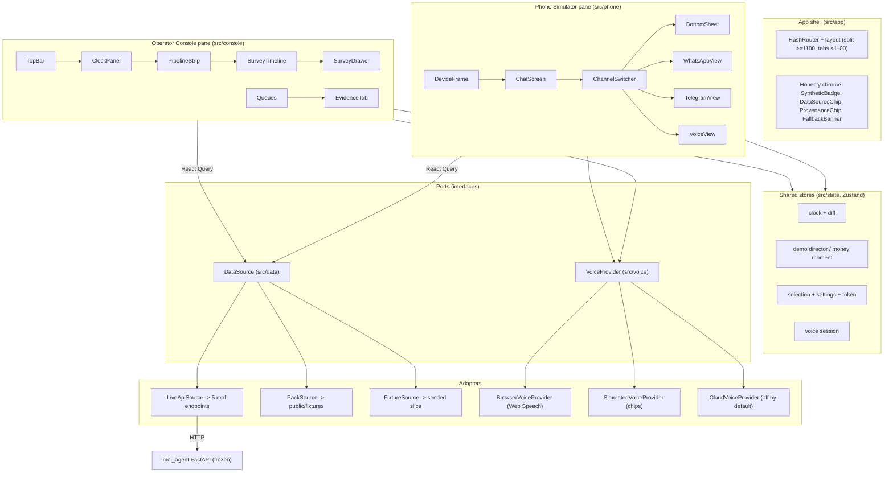
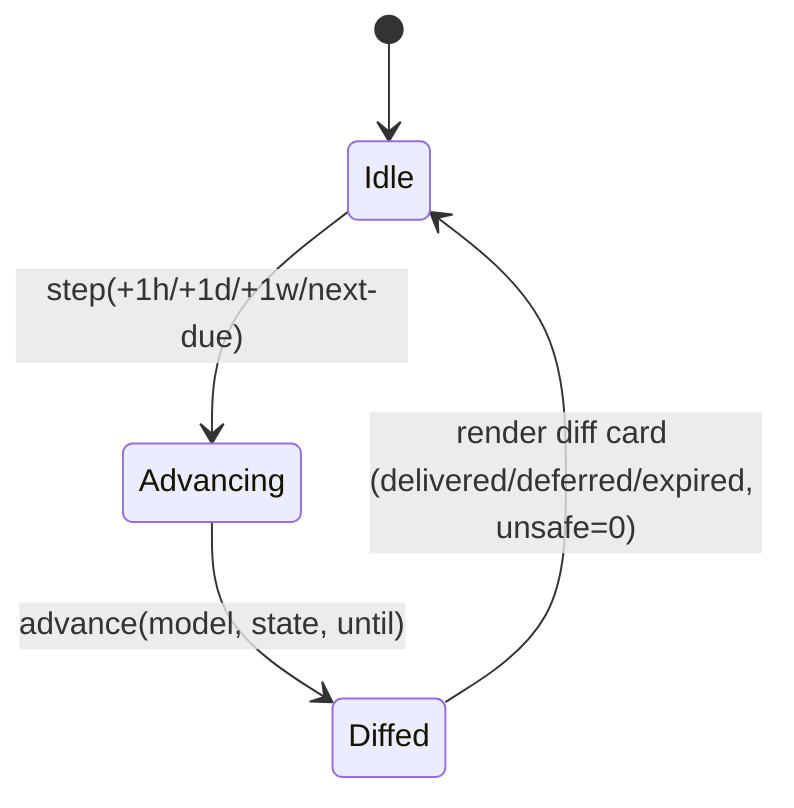
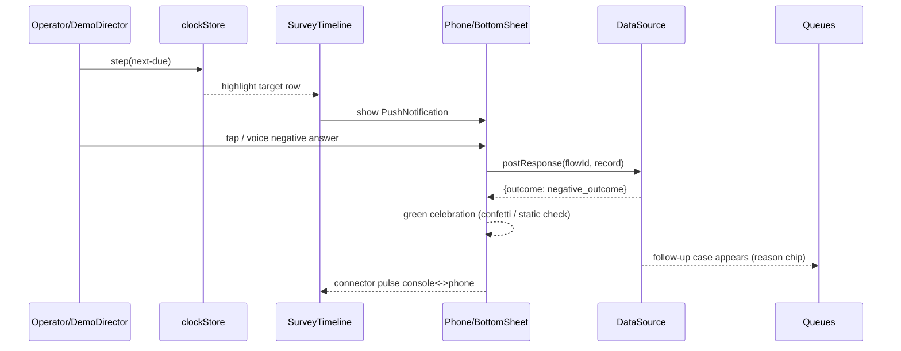
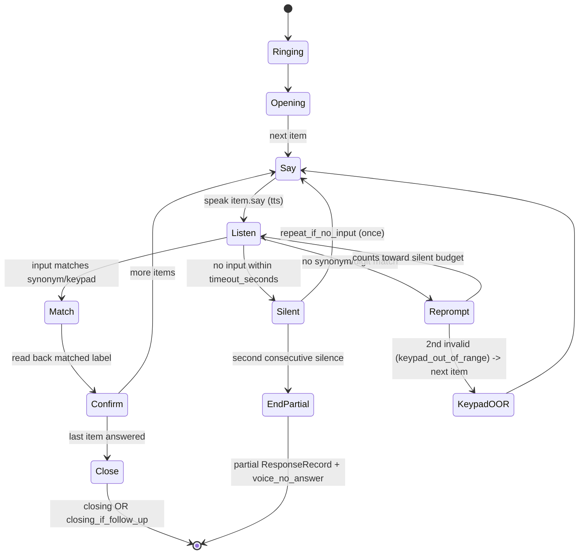
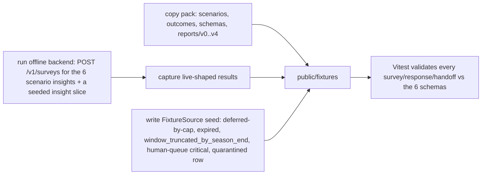
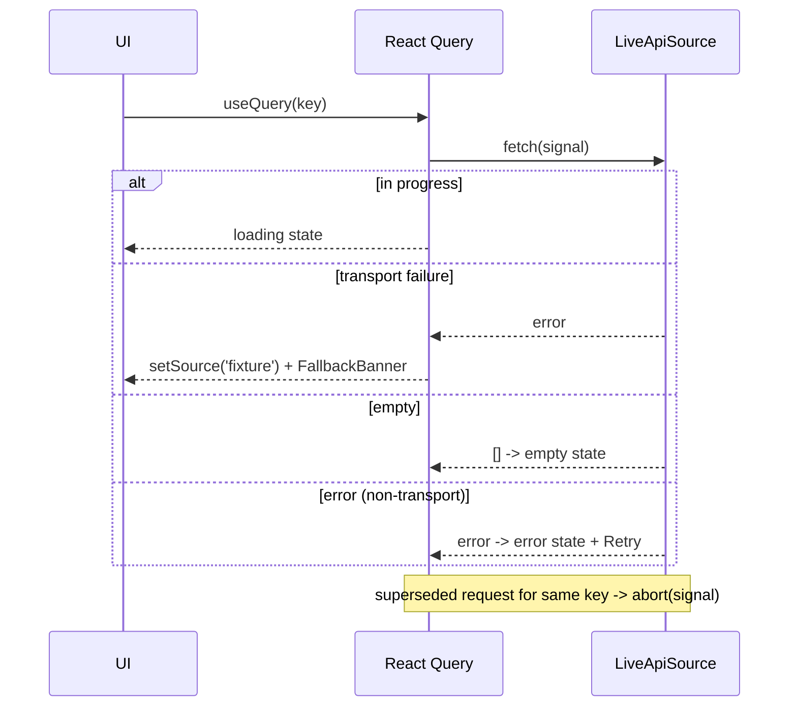

# Design Document: farmerchat-ui

## Overview

`farmerchat-ui` is a single-screen React front end for Team 41's Digital Green
**FarmerChat Contextual MEL Survey Agent**. It renders a split screen — a LEFT
**Operator Console** (~62%) and a RIGHT **Phone Simulator** (~38%) — tied by a
shared simulated clock and a demo director, with **JAAKBOT**, a browser-only
voice module, on both sides. The whole demo traces to three sources only: the
five verified `mel_agent` endpoints, the participant pack, and `reports/v0..v4`.

This document covers architecture, directory layout, the DataSource and
VoiceProvider interfaces (ports-and-adapters), the simulated clock + diff
engine, the pipeline/decide explainability, the Console and Phone component
trees, the Zustand/React-Query state split, the design-token realisation, the
Evidence tab, the fixtures pipeline, the allowed backend touchpoints, and
testing/security. Every section is traced to requirement numbers (`R#.n`).

The design is bound by three approved steering files — **design-tokens**,
**safety-and-honesty**, **never-invent-data** — which are referenced, not
restated. Nothing in this design invents data: panels without a backend
endpoint are labelled "simulated in UI, no backend endpoint", and brief numbers
absent from this repo are shown as "not shown here".

> This feature is predominantly UI rendering, a client-side simulated clock, and
> a deterministic voice/intent state machine. The **Correctness Properties**
> section applies property-based testing only to the handful of pure modules
> where a universal "for all inputs" statement holds (clock/diff, intent matcher,
> sheet-step logic, status-chip mapping, input_kind mapping, response round-trip).
> Rendering, layout, provenance chrome, and endpoint wiring are covered by
> example, snapshot, and integration tests instead.

---

## Architecture

### High-level component diagram (R1, R2, R8, R11, R12)



**Ports-and-adapters framing.** The UI depends on two interfaces only — the
`DataSource` port and the `VoiceProvider` port — never on a concrete backend or
a concrete speech API. This is what lets the same screen run on the live offline
API or on fixtures with zero UI code change (R2.1, R14.5), and lets voice
degrade gracefully when the browser lacks speech support (R11.10).

### Stack (fixed) and the one styling decision

| Concern | Choice | Why |
|---|---|---|
| Framework | React 18 + TypeScript strict + Vite, Node 24 | R16.1 strict TS; Vite fast dev/build |
| Styling | **CSS Modules + `tokens.css`** | Recommended over Tailwind: exact design-token CSS variables live in one file (R15.1), no large utility-class config, CSP-friendly (no runtime style injection), component-scoped class names. Tailwind would add config weight and tempt arbitrary values that bypass tokens. |
| Server cache | React Query (`@tanstack/react-query`) | Caching, cancellation, refetch-after-write, no timer polling (R2.8, R2.9) |
| UI/clock state | Zustand | Simulated clock, demo director, selection, voice session (R4, R14) |
| Animation | Framer Motion, gated by `prefers-reduced-motion` | Sheet spring, confetti, connector pulse (R15.2, R15.3) |
| Icons | `lucide-react` | Icon+label state, never colour alone (R6.5) |
| Fonts | Poppins + Noto Sans Devanagari | **Self-hosted** (not Google CDN) for CSP and offline (R9.6, R15 Hindi) |
| Virtualization | `@tanstack/react-virtual` | Timeline >200 rows stays responsive (R6.4) |
| Charts | Hand-built SVG | Confusion matrix + improvement line (no chart lib) (R13.1, R13.2) |

---

## Directory layout under `/frontend` (R16.2, R16.3)

```
frontend/
  index.html
  .env.example                 # VITE_API_BASE only; no secrets (R16.2)
  vite.config.ts
  src/
    app/
      App.tsx                  # HashRouter, split/tabs layout (R1.1, R1.6)
      Chrome.tsx               # SyntheticBadge, DataSourceChip, ProvenanceChip, FallbackBanner (R1.2-R1.4, R2.4)
      routes.ts                # deep-link targets (#/evidence/golden, #/drawer/schedule ...)
    console/
      TopBar.tsx  ClockPanel.tsx  PipelineStrip.tsx
      SurveyTimeline.tsx  SurveyDrawer.tsx  Queues.tsx
      EvidenceTab.tsx  RequirementsPanel.tsx
    phone/
      DeviceFrame.tsx  ChatScreen.tsx  PushNotification.tsx  ChannelSwitcher.tsx
      BottomSheet.tsx  WhatsAppView.tsx  TelegramView.tsx  VoiceView.tsx
      FarmerSelector.tsx  SimulateBehaviour.tsx
    voice/
      VoiceProvider.ts         # port interface
      BrowserVoiceProvider.ts  SimulatedVoiceProvider.ts  CloudVoiceProvider.ts
      farmerStateMachine.ts    # pure, from voice.json
      intentMatcher.ts         # pure, deterministic
      operatorGrammar.ts       # fixed command table
    data/
      DataSource.ts            # port interface + shared TS types
      LiveApiSource.ts  PackSource.ts  FixtureSource.ts
      queryKeys.ts  client.ts  # React Query client + keys
    state/
      clockStore.ts  demoStore.ts  uiStore.ts  voiceStore.ts
      clockDiff.ts             # pure advance() engine
      rulesExplain.ts          # rules.json -> plain language + R0-R8 labels
      statusChips.ts           # status -> {icon,label} map (pure)
      inputKind.ts             # channel -> input_kind map (pure)
    ui/
      tokens.css               # the ONLY place hex values live (R15.1)
      Backdrop.tsx  SegmentedProgress.tsx  OptionRow.tsx  PrimaryButton.tsx
      Chip.tsx  Confetti.tsx  Dialog.tsx  LiveRegion.tsx
    evidence/
      reports.ts               # read + shape reports/v0..v4
      confusionMatrix.ts       # only-if-computable-from-cases (R13.2)
      schemaBadges.ts
    demo/
      director.ts              # 4-min script + money moment (R14)
  public/
    fixtures/                  # pack artifacts + fixture seed (copied by script)
  scripts/
    fixtures/build-fixtures.ts # npm run fixtures (R3.1)
  tests/                       # Vitest unit
  e2e/                         # Playwright
```

---

## Components and Interfaces

### DataSource port (R2.1, R2.2, R5.4, R7, R8.1, R10.1)

The UI calls one interface. Only five methods reach the live API; the rest are
served from the pack/fixtures because no backend endpoint exists for them.

```ts
export type Language = 'en-IN' | 'hi-IN';
export type Channel = 'app' | 'web' | 'whatsapp' | 'telegram' | 'voice';

export interface DataSource {
  readonly kind: 'live' | 'pack' | 'fixture';

  // ---- served by the 5 verified endpoints (live) / recorded run (pack,fixture)
  health(signal?: AbortSignal): Promise<{ ok: boolean }>;                         // GET /health
  generateSurvey(                                                                  // POST /v1/surveys
    insight: Insight, language: Language, policy: PolicyName, signal?: AbortSignal,
  ): Promise<GenerateResult>;
  getSurvey(surveyId: string, signal?: AbortSignal): Promise<Survey>;             // GET /v1/surveys/{id}
  postResponse(                                                                    // POST /v1/surveys/{flow_id}/responses
    flowId: string, record: ResponseRecord, signal?: AbortSignal,
  ): Promise<{ outcome: OutcomeName; response: ResponseRecord }>;
  getFollowUps(signal?: AbortSignal): Promise<FollowUp[]>;                         // GET /v1/follow-ups

  // ---- read helpers with NO backend endpoint (pack/fixtures only; labelled simulated)
  listScenarios(): Promise<Scenario[]>;
  getRenders(scenarioId: string, lang: Language): Promise<Record<Channel, RenderArtifact>>;
  listTimeline(filter: TimelineFilter, page: Page): Promise<Paged<TimelineRow>>;  // 200 cap
  getStats(): Promise<PipelineStats>;
  getClockModel(): Promise<ClockModel>;      // schedule windows + caps for diff
  getReports(): Promise<Report[]>;           // reports/v0..v4
  getOutcomes(): Promise<OutcomeRecord[]>;   // the 15 real outcome fixtures
  getHumanQueue(): Promise<HumanQueueItem[]>;
}

export type PolicyName = 'baseline' | 'calibrated';
export type GenerateResult =
  | { decision: 'survey'; survey: Survey; handoff: ScheduleHandoff; status: 'scheduled'; no_survey: null }
  | { decision: 'no_survey'; survey: null; handoff: null; status: 'no_survey'; no_survey: NoSurvey };
```

#### Live vs pack/fixture per method

| Method | Live source | Pack source | Fixture source |
|---|---|---|---|
| `health` | `GET /health` | static `{ok:true}` | static `{ok:true}` |
| `generateSurvey` | `POST /v1/surveys` | recorded result per scenario insight | recorded result per seed insight |
| `getSurvey` | `GET /v1/surveys/{id}` | scenario `survey.{lang}.json` | seed surveys |
| `postResponse` | `POST /v1/surveys/{flow_id}/responses` | simulated via outcome_codes | simulated via outcome_codes |
| `getFollowUps` | `GET /v1/follow-ups` | derived from negative scenario responses | seeded follow-ups |
| all read helpers | **pack/fixtures** (no endpoint) | pack | fixture seed |

Only the first five map to real endpoints (R2.2). Read helpers are always
pack/fixture-backed and their panels carry the "simulated in UI, no backend
endpoint" label (safety-and-honesty).

#### Token handling (R2.3, R16.2)
`LiveApiSource` takes the operator token from `uiStore` at call time and sets
`Authorization` in memory only. It is never written to `localStorage`, the URL,
logs, or the repo. Token is entered at runtime via a TopBar field.

#### Auto-fallback (R2.4) + manual switch (R2.5)
A React Query global `onError` (or a fetch wrapper) detects a transport failure
on any live call and dispatches `uiStore.setSource('fixture')`, raising a
`FallbackBanner` ("Live API unreachable — showing fixtures"). A manual
`DataSourceChip` dropdown switches among live/pack/fixture. Switching invalidates
all queries.

#### React Query keys, cancellation, pagination (R2.6-R2.9)

```ts
export const qk = {
  health: ['health'] as const,
  survey: (id: string) => ['survey', id] as const,
  followUps: ['followUps'] as const,
  timeline: (f: TimelineFilter, p: number) => ['timeline', f, p] as const,
  reports: ['reports'] as const,
  // ...
};
```

- Every method takes an `AbortSignal`; React Query cancels superseded in-flight
  requests for the same key (R2.8).
- `listTimeline` enforces a 200-record page cap and returns `Paged<T>` (R2.7).
- Writes (`postResponse`, `generateSurvey`) call `invalidateQueries` on affected
  keys; no `refetchInterval`/timer polling anywhere (R2.9).
- Loading/empty/error states come from React Query status; error state renders a
  retry control (R2.6).

### TS types derived from the real JSON (R7, R9, R10)

Field names match the pack verbatim.

```ts
export interface Insight {
  insight_id: string; farmer_id: string; conversation_id: string;
  created_at: string; conversation_language: Language;
  location: { country: string; state: string; district: string };
  asset: { name: string; category: string; growth_stage: string | null };
  concern: string; behavioral_intent: string; decision_episode_type: string;
  severity: 'low' | 'medium' | 'high' | 'critical';
  query_summary: string; advice_summary: string;
  resolution_type: ResolutionType; action_window_days: number | null;
  verification: { needed: boolean; timing: string; method: string };
  preferred_channel: Channel;
}

export type ResolutionType =
  | 'direct_action' | 'wait_and_monitor' | 'do_not_act' | 'plan_created'
  | 'escalate_to_expert' | 'generic_information' | 'needs_more_context';

export interface Option { value: string; label: string; follow_up?: string }
export type SurveyItemType = 'survey-confirm' | 'survey-single-select' | 'survey-scale';
export interface SurveyItem {
  item_id: string; type: SurveyItemType; prompt: string; options: Option[];
}
export interface Survey {
  survey_id: string; farmer_id: string; source_insight_ids: string[];
  language: Language;
  send_window: { not_before: string; not_after: string };
  items: SurveyItem[]; rationale: string;
  self_eval: { schema_valid: boolean; relevance_score?: number;
               gives_new_advice: boolean; asks_personal_info: boolean };
}
export interface NoSurvey {
  insight_id: string; farmer_id: string; decision: 'no_survey';
  reason_code: string; reason: string;
}
export interface ScheduleHandoff {
  handoff_id: string; created_at: string; survey: Survey;
  send_window: { not_before: string; not_after: string };
  send_hours: { from: string; to: string };
  channel_order: { channel: Channel; wait_hours: number | null }[];
  frequency_cap: { key: string; max_surveys: number; window_days: number; exempt: boolean };
  priority: 'low' | 'normal' | 'high'; expires_at: string;
  farmerchat_flow: {
    org_id: string; flow_key: string; version: number;
    campaign_id: string; flow_id: string;
  };
}
export type InputKind =
  | 'sheet_tap' | 'button_reply' | 'callback_data' | 'keypad' | 'speech' | 'free_text';
export interface ResponseItem {
  item_id: string; item_type: SurveyItemType;
  result: 'answered' | 'skipped' | 'invalid';
  value: string | null; raw_input: string | null;
  input_kind: InputKind; attempts: number;
}
export interface ResponseRecord {
  response_key: string; survey_id: string; farmer_id: string;
  source_insight_ids: string[]; channel: Channel; language: Language;
  status: string; failure_code: string | null;
  sheet_outcome: SheetOutcome | null;
  answers: Record<string, string>; items: ResponseItem[];
  complete: boolean; delivery_attempt: number;
  timestamps: { sent?: string; delivered?: string; opened?: string; answered?: string };
  recorded_at: string; answered_by: string; raw_event: unknown | null;
  retry_decision: RetryDecision; retry_after_minutes: number | null;
  counts_toward_cap: boolean;
  farmerchat_reply: { http_status: number; outcome: string } | null;
  needs_follow_up: boolean; follow_up_reasons: string[];
}
export type SheetOutcome =
  'finished' | 'closed_partway' | 'interrupted' | 'dismissed' | 'never_opened';
export type RetryDecision =
  'none' | 'give_up' | 'retry_same_channel' | 'fall_back_to_next_channel';

// --- render artifacts ---
export interface VoiceItem {
  item_id: string; say: string;
  keypad: Record<string, string>;            // "1" -> option value
  speech: Record<string, string[]>;          // option value -> synonyms
  timeout_seconds: number; repeat_if_no_input: number;
}
export interface VoiceRender {
  channel: 'voice'; how_it_arrives: string; opening: string;
  items: VoiceItem[]; closing: string; closing_if_follow_up: string;
}
export interface SheetStep {
  step: number; step_label: string; item_id: string;
  question_type: SurveyItemType; question: string;
  options: { label: string; answer: string }[];
}
export interface BottomSheetRender {
  channel: 'app' | 'web';
  how_it_arrives: string;
  presentation: {
    type: 'bottom_sheet'; opens_when: string[]; waits_for: string[];
    one_question_per_step: boolean; steps_total: number;
    can_skip: boolean; can_close: boolean; swipe_down_closes: boolean;
  };
  sheet: { title: string; skip_label: string; close_label: string;
           thank_you: string; steps: SheetStep[] };
}
export type RenderArtifact = BottomSheetRender | VoiceRender | ChatRender;

// --- reports/v0..v4 ---
export interface Report {
  name: string; policy: string; language: Language; golden_cases: number;
  writer_model: string; prompt_version: string; at: string;
  scores: Record<string, number | boolean>;       // decision_accuracy ... gate_ok
  speed: {
    batch_wall_seconds: number;
    seconds_per_survey_avg: number; seconds_per_survey_p95: number;
    agent_usage: Usage; eval_judge_usage: Usage;
  };
  status_counts: { scheduled: number; rejected: number;
                   writer_skipped: number; no_survey: number; error: number };
  rule_mismatches: unknown[];
  cases: ReportCase[];
}
export interface Usage {
  calls: number; input_tokens: number; output_tokens: number;
  seconds: number; cost_usd: number | null; by_model: Record<string, unknown>;
}
export interface ReportCase {
  golden_id: string; insight_id: string;
  expected_survey: boolean; agent_survey: boolean;
  expected_rule: string; agent_rule: string; status: string;
  survey?: Survey; /* + per-case eval fields */
}
export interface FollowUp {
  survey_id: string; farmer_id: string; reason: string; /* reason chip */
}
export interface OutcomeCode {
  retry_decision: RetryDecision; counts_toward_cap: boolean;
  status?: string; channels?: Channel[]; retry_after_minutes?: number | null;
  meaning: string;
}
```

---

## Data Models

### Simulated clock + diff engine (R4)

The clock and its diff are UI-only; there is no backend clock (R4.1, R4.6). The
diff is a **pure function** over the clock model.

```ts
export interface ClockModel {
  surveys: {
    survey_id: string; farmer_id: string;
    not_before: string; not_after: string; expires_at: string;
    counts_toward_cap: boolean; priority: 'low' | 'normal' | 'high';
    outcome?: OutcomeName;         // from the 15 outcome fixtures
  }[];
  season_end: string;              // '2027-03-31' from rules.json
  cap: { max_surveys: number; window_days: number; exempt_priority: string[] };
}
export interface ClockState { nowIso: string }    // IST
export interface Diff {
  delivered: string[]; deferredByCap: string[]; expired: string[];
  blockedUnsafe: 0;                 // always 0 (R4.5)
  newClock: string;
}
export function advance(model: ClockModel, state: ClockState, until: string): Diff;
```

`advance` classifies each affected survey (R4.3, R4.4):
- **expired** if `until > expires_at` or `not_after > season_end`
  (season end `2027-03-31` from `rules.json`, R-Assumption 7).
- **deferred-by-cap** if another survey to the same `farmer_id` was delivered
  within `window_days` and the survey is not cap-exempt by priority.
- **delivered** otherwise, within send hours `07:00–19:00`.
- `blockedUnsafe` is always `0` (R4.5).

"Jump to next due survey" = min `not_before >= now` across the model; the clock
steps to that instant. Steps provided: +1h, +1d, +1w, next-due (R4.2).



`clockStore` (Zustand): `{ nowIso, model, lastDiff, step(kind), jumpToNextDue() }`.
Clock changes are announced via an ARIA live region (R15.6).

### Pipeline + decide explainability (R5)

| Stage | Source | Live? |
|---|---|---|
| Ingest | `insights.jsonl` via DataSource; valid vs quarantined counts | pack/fixture (R5.2, R5.6) |
| Decide | `rulesExplain.ts` maps `rules.json` to plain language | pack (R5.3) |
| Generate | `POST /v1/surveys` for one insight | **live** (R5.4) |
| Schedule | `schedule_handoff` + `rules.json` | pack/live |
| Deliver | outcome fixtures | simulated (R5.6) |
| Answer | `postResponse` / simulated | live or simulated |

**R0–R8 is a display convention only.** `rules.json` expresses eligibility by
`resolution_type` and named window/priority/channel/cap rules (no literal R#
identifiers). `rulesExplain.ts` maps resolution types to display labels and
surfaces the underlying rule text verbatim; no rule logic is invented
(R-Assumption 6). Example mapping:

| resolution_type | survey? | plain-language reason (from rules.json `asks`) | display label |
|---|---|---|---|
| `direct_action` | yes | "Did the farmer do it, and did it work?" | R8 |
| `generic_information` | no | "No action was advised, so there is nothing to follow up." | R1 |
| `needs_more_context` | no | "No advice was given yet; the conversation is still open." | (as in reports `cases`) |

Report `cases` carry `expected_rule`/`agent_rule` as `R#` already; the UI reuses
those labels and shows the rule text behind each.

Running Generate disables the run control while in flight; repeated triggering is
idempotent (same insight -> same query key, deduped) (R5.5).

---

## Correctness Properties

*A property is a characteristic that should hold across all valid executions —
a formal statement of what the system should do, bridging the spec and
machine-verifiable tests.* Only the pure modules below admit universal
properties; everything else is covered by example/snapshot/integration tests
(see Testing Strategy).

Prework classification (summarised from the acceptance criteria): clock/diff
classification, the intent matcher, sheet-step logic, status-chip mapping,
input_kind mapping, and the response round-trip are PROPERTY-testable; the
layout/chrome/rendering/endpoint-wiring criteria are EXAMPLE, SNAPSHOT, or
INTEGRATION and are excluded here.

### Property 1: Clock diff partitions affected surveys
*For any* `ClockModel` and any advance target, every affected survey appears in
exactly one of `delivered`, `deferredByCap`, or `expired`, and `blockedUnsafe`
is always `0`.
**Validates: Requirements 4.3, 4.4, 4.5**

### Property 2: Expiry respects season end and expires_at
*For any* survey, if the advance target is after its `expires_at` or its
`not_after` is after `season_end` (`2027-03-31`), then it is classified
`expired`.
**Validates: Requirements 4.3, 4.4**

### Property 3: Frequency cap defers within window
*For any* two non-exempt surveys to the same `farmer_id` whose send windows fall
inside `window_days`, advancing past both classifies the second as
`deferredByCap`.
**Validates: Requirements 4.3, 4.4**

### Property 4: Intent matcher accepts only the current item's synonyms/digits
*For any* voice item and any input, the matcher returns a value only when the
normalised input equals one of that item's `speech` synonyms or `keypad` digits;
otherwise it returns no-match, and it never returns a value from another item.
**Validates: Requirements 11.4, 11.5, 12.2**

### Property 5: Two silent prompts end the call as partial
*For any* voice render and any run where two consecutive prompts receive no
input, the state machine ends the call and emits a partial `ResponseRecord`
carrying the answers given so far.
**Validates: Requirements 11.1, 11.2, 11.5**

### Property 6: Sheet step logic is monotonic and bounded
*For any* `BottomSheetRender`, advancing through steps visits each step once in
order, uses the backend `step_label`, and reaches the backend `thank_you` only
after the last step (or stops early on skip/close).
**Validates: Requirements 9.4, 10.1, 10.2**

### Property 7: Status-chip mapping is total and icon+label
*For any* survey status, `statusChips` returns exactly one `{icon, label}` pair,
never colour alone and never undefined.
**Validates: Requirements 6.2, 6.5**

### Property 8: Voice vs tap responses differ only by input_kind
*For any* answered survey, the `ResponseRecord` produced by a voice run and the
one produced by a tap run are identical except for each item's `input_kind`.
**Validates: Requirements 10.5**

### Property 9: Input_kind matches the channel
*For any* channel, every `ResponseItem.input_kind` it produces is a member of
that channel's allowed set (app→sheet_tap, whatsapp→button_reply/free_text,
telegram→callback_data/free_text, voice→keypad/speech).
**Validates: Requirements 10.5, 11.3**

---

## Component tree

### Operator Console (R5, R6, R7, R8, R12, R13)

```
Console
├─ TopBar            chips (SyntheticBadge, DataSourceChip, ProvenanceChip), token field, mic (R12.1)
├─ ClockPanel        IST clock + season scrubber + step buttons + diff card (R4)
├─ PipelineStrip     SegmentedProgress: Ingest→Decide→Generate→Schedule→Deliver→Answer (R5.1)
├─ SurveyTimeline    @tanstack/react-virtual rows + state chips + filters (R6)
├─ SurveyDrawer      source insight, decision, items/options/follow_ups, self-eval,
│                    send-window mini-timeline, channel order+rationale, provenance,
│                    response answers/status/failure_code/follow_up (R7)
├─ Queues            FollowUpQueue (GET /v1/follow-ups) | HumanQueue (simulated label) (R8)
└─ EvidenceTab       scores grid, improvement SVG, status_counts, telemetry, schema badges,
                     RequirementsPanel (live, deep links), honesty footer (R13)
```

### Phone Simulator (R9, R10, R11, R15)

```
Phone
├─ DeviceFrame       CSS frame, 9:41 status bar, home pill (R9.1, design-tokens)
├─ ChatScreen        advice message + PushNotification (R9.1)
├─ FarmerSelector    name/district/crop/language + next-due shortcut (R9.2)
├─ ChannelSwitcher   App | Web | WhatsApp | Telegram | Voice (R9.3)
├─ BottomSheet       ARIA dialog; SegmentedProgress, OptionRow, PrimaryButton, Confetti;
│                    step_label, skip/close/swipe-down, thank_you; opens_when/waits_for tooltip;
│                    mic button -> JAAKBOT farmer voice (R9.4, R9.5, R11.8, R15.5)
├─ WhatsAppView / TelegramView / VoiceView   render exactly from render/{lang}/{channel}.json (R9.3)
└─ SimulateBehaviour replays outcome_codes grid with retry_decision/after/cap (R10.3)
```

Shared primitives live in `src/ui` (SegmentedProgress, OptionRow, PrimaryButton,
Chip, DeviceFrame, Backdrop, Confetti, Dialog, LiveRegion) and consume only
`tokens.css` variables (R15.1).

---

## State model (R2, R4, R10, R14)

| Lives in | Data |
|---|---|
| **React Query** (server/derived cache) | survey, follow-ups, timeline pages, reports, renders, outcomes, health — anything fetched through a DataSource method |
| **Zustand `clockStore`** | `nowIso`, clock model, last diff, step/jump actions |
| **Zustand `demoStore`** | demo director step index, playing/paused, money-moment phase |
| **Zustand `uiStore`** | selection (active survey/farmer/channel/language), active DataSource, operator token (in memory), settings (paid-inference off, cloud-STT off) |
| **Zustand `voiceStore`** | voice session: current item, listening flag, captions, silent-prompt budget |

Rule of thumb: **server truth → React Query; UI/simulation truth → Zustand.**

### Money moment sequence (R14.4)



Must complete within 20s on both Fixture_Source and live offline Backend_API
(R14.4, R14.5).

---

## VoiceProvider port and JAAKBOT

### VoiceProvider interface (R11, R12) — no required cloud keys

```ts
export interface VoiceProvider {
  readonly kind: 'browser' | 'simulated' | 'cloud';
  readonly leavesBrowser: boolean;            // true only for cloud
  isSpeechSupported(): boolean;               // feature detection (R11.10)
  stt(lang: Language, onPartial: (t: string) => void): SttSession;   // start/stop
  tts(text: string, lang: Language): Promise<void>;                  // speechSynthesis
  intentMatcher: IntentMatcher;               // swappable, deterministic
}
```

- **BrowserVoiceProvider** — Web Speech API + `speechSynthesis`, feature-detected
  per language; caption fallback when speech unavailable (R11.7, R11.10).
- **SimulatedVoiceProvider** — chip row from render `speech` synonyms; TTS is a
  silent WAV + captions; always available (R11.3).
- **CloudVoiceProvider** — placeholder, **off by default**, shows a persistent
  "audio leaves the browser" indicator when enabled (safety-and-honesty).

No audio is recorded/stored/sent by default; the mic activates only on tap with a
visible listening state and one-click stop.

### Farmer-side voice state machine (R11.1–R11.7) — strictly from `voice.json`



- Two consecutive silent prompts → end call, save partial (R11.2).
- `keypad_out_of_range`: a key with no answer twice → move to next question
  (from `outcome_codes.json`).
- Hindi speech captured → marked "needs human review" (R11.9).
- Browser without speech → keypad + simulate-speech chips, flow continues
  (R11.10).

### Deterministic intent matcher (R11.4, R11.5, R12.2)

```
match(input, item):
  n = normalise(input)              # trim, lowercase, strip punctuation, fold digits
  if n is a key of item.keypad: return item.keypad[n]
  for value, synonyms in item.speech:
      if n == normalise(synonym) for any synonym: return value
  return NO_MATCH                   # -> polite re-prompt, counts toward budget
```

No LLM; matches only the **current** item's synonyms and keypad digits; never
free-generated (R11.4, R12.2).

### Operator-side fixed command grammar (R12.1–R12.4)

| Phrase | Action | Destructive? |
|---|---|---|
| "advance one day" | `clockStore.step('+1d')` | no |
| "jump to next due survey" | `clockStore.jumpToNextDue()` | no |
| "open follow-up queue" | route `#/queues/follow-ups` | no |
| "show Hindi" | `uiStore.setLanguage('hi-IN')` | no |
| "show evidence" | route `#/evidence` | no |
| "start demo" | `demoStore.start()` | no |
| "reset" | `demoStore.reset()` | **yes → confirm** (R12.4) |

Recognised command shows a toast (R12.3); "read this aloud" narrates the open
drawer/Evidence summary using on-screen data only (R12.5); every action is
mouse+keyboard reachable (R12.6).

### input_kind mapping per channel (R10.5, R11.3)

| Channel | input_kind |
|---|---|
| app / web | `sheet_tap` |
| whatsapp | `button_reply` (or `free_text` → `free_text_instead_of_choice`) |
| telegram | `callback_data` (or `free_text`) |
| voice | `keypad` or `speech` |

---

## Design tokens realised (R15, design-tokens steering)

`src/ui/tokens.css` is the **only** place colour literals live (R15.1). Variable
list mirrors the steering palette: `--green-deep #1B5E20`, `--green-brand
#2E7D32`, `--green-brand-alt #2F6B3A`, `--green-light #E5F0E3`, `--green-light-2
#C8E6C9`, `--white`, `--page-tint #F7F8F5`, `--ink #1D231C`, `--muted #5D6A5A`,
`--line #DDE3D8`, backdrop blobs `#E8F5E9/#C8E6C9/#F7FBF6`, semantic amber
(`#8A4B0F` on `#FBEEDD`), deep red for critical only. Shape/type tokens: phone
radius 44–48px, console cards 20px, option rows 56–60px, primary pill ~60px.

Reusable token consumers: `SegmentedProgress` (filled `--green-brand`, rest
`--green-light-2`), `OptionRow` (24px radio, 2px ring, selected `--green-light`
tint + spring), `PrimaryButton` (full-width pill, UPPERCASE, disabled until
choice), `Chip` (icon+label), `DeviceFrame`, `Backdrop` (gradient blobs),
`Confetti` (static green check under `prefers-reduced-motion`). No emoji
anywhere (design-tokens Do-NOT).

**Responsive** (R1.1, R1.6, R1.7): `>=1100px` split 62/38; `<1100px` stack into
"Console | Phone" tabs; phone works alone at 360px with Hindi non-clipping
(Noto Sans Devanagari, wrapping, no fixed-width option rows).

**Accessibility** (R15.4–R15.7): BottomSheet is an ARIA dialog with focus trap
and restore (R15.5); clock changes and JAAKBOT captions announce through ARIA
live regions (R15.6); visible focus indicator on every interactive element
(R15.4); all backend strings rendered as text nodes, no raw PII beyond engine
fields (R15.7).

---

## Evidence tab design (R13)

| Panel | Source | Honesty rule |
|---|---|---|
| Scores grid | `reports/v4` `scores` (decision/rule/recall/precision/window/channel/format/safety = 1.0, relevance 0.937, reference_intent 0.916) | real numbers only |
| Improvement line | v0→v4 per-metric, hand-built SVG | R13.1 |
| status_counts | `reports/v4` (scheduled 95 / no_survey 55 / rejected 0 / error 0) | R13.1 |
| 2×2 confusion matrix | derived from `cases` (`expected_survey` vs `agent_survey`) **only if computable**; else "not shown here" | R13.2; brief TP93/FP0/TN55/FN2 never shown as fact |
| Hindi validity | count of schema-valid hi-IN surveys present | R13.3 |
| Telemetry | `reports.speed` (`seconds_per_survey_avg/p95`, tokens); **cost = "not evidenced"** (`cost_usd` null) | R13.4 |
| Schema badges | six badges, one per `json/schemas/*.json` | R13.5 |
| RequirementsPanel | live from the traceability table; deep link per row | R13.6 |
| Open questions | this spec's Open Questions; note `CONTRACT_QUESTIONS.md` absent | R13.7 |
| Honesty footer | fixed text "Self-reported, simulated answers. Not causal evidence. RCTs remain the verifier." | R13.8 |

`confusionMatrix.ts` computes the 2×2 from each case's `expected_survey` /
`agent_survey` booleans; if a report lacks per-case booleans it returns null and
the panel renders "not shown here" (R13.2).

---

## Fixtures pipeline (R3, R16)

`scripts/fixtures/build-fixtures.ts` (`npm run fixtures`, R3.1):



- Pack artifacts and `reports/v0..v4` are copied into `public/fixtures`.
- A real offline backend run (`POST /v1/surveys` for the six insights plus a
  seeded slice) captures live-shaped decision/survey/handoff results (R3.1).
- The FixtureSource seed adds states the scenarios lack: deferred-by-cap,
  expired, `window_truncated_by_season_end`, a critical human-queue item, and a
  quarantined ingest row.
- A Vitest test validates every generated survey, `ResponseRecord`, and
  `ScheduleHandoff` against the six pack schemas; any failure fails the test
  (R3.2, R3.3).
- **Drop-in swap** (R3.4): README documents replacing fixture files or pointing
  `VITE_API_BASE` at the live API — no UI code change.

---

## Backend touchpoints (R-Assumption 4, safety-and-honesty)

The `mel_agent` behaviour is frozen. Only two **additive, off-by-default,
config-gated** edits are allowed; neither changes behaviour:

1. **CORS for the dev origin** — gated by an env var (e.g.
   `MEL_CORS_DEV_ORIGIN`). When unset, no CORS middleware is added. Minimal
   approach (described, not implemented here): read the env var at startup and,
   only if present, add FastAPI `CORSMiddleware` allowing that single origin for
   the five existing routes.
2. **Optional static serving** of the built UI — gated by an env var; when unset,
   nothing is served.

No new endpoints, no auth changes, no response-shape changes.

---

## Error Handling



Loading shows skeletons; empty shows an explicit empty state; non-transport
errors show a retry control; transport failure triggers the fixture fallback
banner (R2.4, R2.6). Superseded same-key requests are cancelled (R2.8).

---

## Testing Strategy

PBT applies only to the pure modules in Correctness Properties; everything else
uses example/snapshot/integration tests.

### Vitest unit (R16.3)

| Target | Type |
|---|---|
| Three DataSources (live mocked, pack, fixture) | example + integration |
| Fixture schema validation vs six schemas | example (R3.2) |
| `advance()` clock/diff | **property** (P1–P3) |
| `intentMatcher` over every `speech` synonym × 6 scenarios × 2 langs | **property** (P4) |
| Farmer voice state machine | **property** (P5) |
| Sheet step logic | **property** (P6) |
| `statusChips` mapping | **property** (P7) |
| Response round-trip (voice vs tap) + input_kind | **property** (P8, P9) |
| `rulesExplain` label mapping | example |

Property tests use `fast-check`, ≥100 runs each, tagged
`// Feature: farmerchat-ui, Property N: <text>`.

### Playwright e2e (R16.4–R16.6)
Run against **both** Fixture_Source and the live offline Backend_API:
money moment by tap and by simulated speech; Hindi rendering (no clipping at
360px); channel switching; API-down fallback banner; follow-up after a negative
answer; operator command grammar. Assert **no console errors** during covered
flows (R16.5). Screenshots captured at DSF2 (1440×900) and at 360px for
reference comparison; all serious axe findings resolved (R16.6).

---

## Security / CSP (R15.7, R16.1, R16.2)

- Text-node rendering only; no `innerHTML` / `dangerouslySetInnerHTML` (R16.1).
- Backend data treated as untrusted though synthetic.
- Operator token in memory only; never `localStorage`, URL, logs, or repo
  (R2.3).
- `.env.example` declares `VITE_API_BASE`; no secrets committed (R16.2).
- Fonts self-hosted (no third-party CDN) to keep a strict CSP and offline
  operation.
- No raw PII beyond engine-returned fields (R15.7).

---

## Design decisions and tradeoffs

- **CSS Modules + tokens.css over Tailwind.** Keeps every colour literal in one
  tokenised file (R15.1), avoids a heavy utility config, and is CSP-friendly
  (no runtime style injection). Tailwind would tempt arbitrary values that
  bypass tokens. Tradeoff: slightly more boilerplate per component.
- **`@tanstack/react-virtual`** for the timeline — lightweight, headless, pairs
  cleanly with React Query; avoids a heavier grid dependency (R6.4).
- **Framer Motion over hand-rolled CSS** for sheet spring, confetti, and the
  connector pulse — one consistent, `prefers-reduced-motion`-aware API
  (R15.2, R15.3). Tradeoff: a dependency; gated so reduced-motion users get a
  static green check.
- **Hand-built SVG** for the confusion matrix and improvement line — no chart
  library, full control of the honest "not shown here" state (R13.1, R13.2).
- **Honesty of simulated panels.** Every panel without a backend endpoint
  (clock, diff, stats, human queue, batch counts) carries a fixed "simulated in
  UI, no backend endpoint" label sourced from pack/fixtures, never invented; the
  Synthetic_Badge is persistent and non-dismissable.

---

## Open questions carried into design

From requirements.md Open Questions:
1. Does `mel_agent` later gain a batch/broadcast or clock endpoint, or do those
   stay simulated-in-UI? (Affects whether ClockPanel/batch counts move from
   "simulated" to Evidenced.)
2. Will the real dataset include human-queue and quarantine states, letting
   those panels move from "simulated in UI" to Evidenced?
3. Who owns Hindi native-speaker review of the UI-chrome dictionary strings?
4. Authoritative source for the golden confusion-matrix numbers, absent from
   this repo?
5. Should taps persist when no FarmerChat flow exists, or is "simulated tap, not
   persisted" the intended final behaviour? (Affects `postResponse` vs local
   simulation in R10.1/R10.2.)
