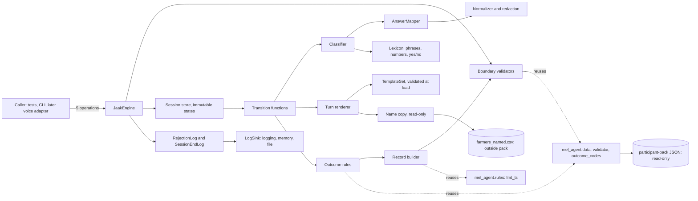
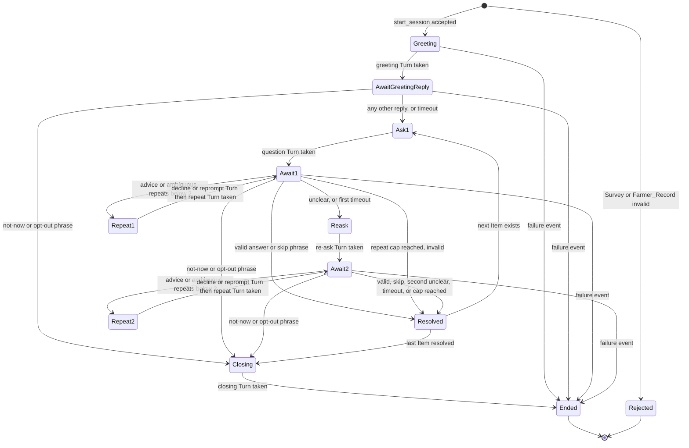

# Design Document: jaak-core

## Overview

JAAK_Engine is a text-only, deterministic dialogue engine. For one Survey and one Farmer_Record it produces a sequence of Turns and one Response_Record that validates against `response.schema.json`. It lives in a new package `mel_agent/jaak/`. No existing `mel_agent/` module is edited (Req 20.5).

Design drivers:

- **No free text generation.** Every Turn is assembled from four sources only: Survey prompt, Survey option label, a fixed template, and the greeting-only `farmer_name` (Req 16.1, 16.5). Each Turn carries a segment list that records the source of every character, so this is testable.
- **Pure core, thin shell.** Answer mapping, classification, state transitions, status derivation and record building are pure functions. `JaakEngine` holds sessions, a clock, a log sink and loaded templates, and commits a new state only when a transition succeeds. Errors therefore leave state unchanged (Req 6.7, 20.7).
- **Validate at every Boundary** with `jsonschema` (authoritative) plus Pydantic (typed). Reject, log once, pass nothing on (Req 1, 19).
- **Fail fast at load.** Templates and outcome codes are validated when the engine is constructed (Req 7.7, 11.14).
- **Offline and dependency-light.** The package imports only the standard library, `pydantic`, `jsonschema`, `referencing`, and three existing read-only `mel_agent` modules (Req 20.2, 20.4).

### Research findings that shaped the design

| Finding (source: repo inspection) | Design consequence |
|---|---|
| `mel_agent/data.py` already exposes `validator(name)`, `schema_errors`, `outcome_codes()` with a `referencing` registry for the cross-file `$ref`s in `response` and `schedule_handoff`. | Reuse `data.validator` and `data.outcome_codes()` (read-only import). No second schema loader. |
| `mel_agent/rules.py` imports only stdlib and `data`; `fmt_ts` renders IST `+05:30` timestamps. `responses.py` shows the repo's record conventions (`rk-{survey_id}-{channel}-{attempt}`). | Reuse `rules.fmt_ts`; copy the `response_key` convention with channel `voice`. Do not import `responses.py` (it holds the simulator). |
| Importing `api`, `llm`, `writer`, `checker` pulls in `boto3`/`fastapi`. | `mel_agent.jaak` must never import them. An AST allowlist test enforces this (Req 20.2). |
| `survey.schema.json` allows any `xx-XX` language and `farmer_id` up to 64 chars; `response.schema.json` caps `farmer_id` and `answered_by` at 64 and `raw_input` at 256. Option labels are at most 20 chars. | The Req 1.3 limit of 64 matches both schemas. The supported-language check (exactly `hi-IN` or `en-IN`) is an extra check on top of the schema. |
| `farmers.csv` has 300 rows, languages `hi-IN` (270) and `en-IN` (30), no name column. | Both languages in the data are supported; hi-IN is the main path and needs the most Hindi test coverage. |
| The pack ships `survey.en-IN.json` and `survey.hi-IN.json` for scenarios 1 to 5; scenario 6 ships `no_survey.json`. | Scenario tests use the shipped surveys: 5 scenarios x 2 languages = 10 records, plus the scenario 6 `no_survey` check (Req 20.6). |
| There is no `tests/` directory, no test libraries in `requirements.txt`, and the local interpreter is Python 3.9 while the repo targets 3.12 (existing code uses `X \| None`). | A new `tests/` tree and `requirements-dev.txt` are created. Tests run on 3.12. |
| Python `\w` and `re` word splitting break Devanagari words because vowel signs are combining marks (not alphanumeric). | The tokenizer splits on whitespace and Unicode punctuation categories, never on `\w`. |

## Architecture

### Package layout

```
mel_agent/jaak/
  __init__.py        public exports: JaakEngine, Turn, Segment, CallTimes, events, errors
  engine.py          JaakEngine: five operations, session store, commit-on-success
  session.py         immutable SessionState, ItemState, pure transition functions
  classify.py        utterance classification (mapper first, then phrase lists)
  mapper.py          AnswerMapper: select/confirm and scale mapping (pure)
  normalize.py       text normalisation, tokenizer, PII/redaction detection (pure)
  lexicon.py         phrase lists, yes/no sets, number words, advice lexicon (data only)
  templates.py       TemplateSet loader + load-time validator (Req 7)
  templates/en-IN.json, templates/hi-IN.json     fixed template text, one file per language
  render.py          Turn assembly from segments
  outcome.py         follow-up derivation, status precedence, failure-record fields
  record.py          Response_Record builder + final validation
  models.py          Pydantic models for the six schemas, FarmerRecord, Turn, events
  boundary.py        Boundary validators (jsonschema + Pydantic) -> BoundaryResult
  logs.py            LogSink, RejectionLog, SessionEndLog entry builders, name scrub
  names.py           Farmer_Name_Copy loader (read-only)
  settings.py        env-driven settings (name copy path), kept out of mel_agent/config.py
  errors.py          exception hierarchy
  cli.py             developer CLI (design addition, see "Design additions")
tests/
  conftest.py, jaak/{unit,properties,adversarial,scenarios,integration}/
  fixtures/jaak/     hand-written surveys, scripted answers
requirements-dev.txt (new file; requirements.txt untouched)
pytest.ini           (new file)
```

### Component diagram



Rules for the diagram: dashed edges are read-only imports of existing modules; nothing in `mel_agent/` outside `jaak/` is modified. The two cylinders are the only files the engine reads at runtime. The engine writes no files; the log sink is injected.

### Dialogue_Session state diagram



`Ended` means the Response_Record is built and cached. Failure events that need no closing Turn (Req 14.6) go straight to `Ended`. Calls to any operation on `Rejected` (no session exists) or after finalisation raise errors.

### Requirement coverage by component

| Requirement | Main components |
|---|---|
| 1, 19 | `boundary.py`, `models.py`, `logs.py`, `record.py` |
| 2, 3, 4, 6, 7, 14, 16.1 | `templates.py`, `render.py`, `names.py` |
| 5, 10, 11, 12.10, 16.2 to 16.8 | `session.py`, `classify.py` |
| 8, 9, 17.2, 17.6, 18 | `mapper.py`, `normalize.py`, `lexicon.py` |
| 12, 13, 15 | `outcome.py`, `record.py` |
| 20 | `engine.py`, `errors.py`, AST/offline tests |

## Components and Interfaces

### Public interface (Req 20.3)

`JaakEngine` exposes exactly five public operations. Construction is not an operation.

```python
class JaakEngine:
    def __init__(self, *, clock: Callable[[], datetime], log: LogSink | None = None,
                 name_copy_path: Path | None = None, id_factory: Callable[[], str] | None = None)

    def start_session(self, survey: dict, farmer: dict, *, delivery_attempt: int = 1,
                      call_times: CallTimes | None = None) -> str          # 1
    def next_turn(self, session_id: str) -> Turn | None                    # 2
    def submit_answer(self, session_id: str, text: str, *,
                      utterance_complete: bool) -> AnswerReceipt            # 3
    def submit_event(self, session_id: str, event: CallerEvent) -> None     # 4
    def get_response(self, session_id: str) -> dict                         # 5
```

Construction loads and validates templates (Req 7.7), loads `outcome_codes.json` and checks every reportable code (Req 11.14), and reads the optional name copy. Any failure raises at construction and no session can start.

| Operation | Behaviour | Errors (state unchanged) |
|---|---|---|
| `start_session` | Validates `delivery_attempt` (int, not bool, 1 to 5; Req 15.5), Survey, Farmer_Record, pair, languages (Req 1, 3). On success creates the session, renders and queues the greeting Turn, returns an opaque `session_id`. Writes the language-mismatch warning (Req 3.5). | `InputRejected`, `InvalidRequest`, `LanguageUnavailable`, `GreetingFailed` (Req 2.5, 2.6). No session is created. |
| `next_turn` | Pops the next queued Turn, or returns `None` when none is pending. Never generates a Turn for the next Item before the current Item is resolved (Req 5.5). | `UnknownSession`, `SessionFinalised` |
| `submit_answer` | Accepts text only when the session awaits a reply, the queue is empty, and `utterance_complete` is true. If `utterance_complete` is false it returns `AnswerReceipt.IGNORED` and changes nothing (Req 5.8, 5.9). Empty or whitespace-only text is accepted and classified Unclear (Req 18.7). | `InvalidRequest` for non-string or over 2,000 chars (Req 18.8, 20.1, 20.7: error, state unchanged, no Turn, one Rejection_Log entry, no text logged); `OutOfOrder` when Turns are pending or no reply is awaited |
| `submit_event` | Applies a caller event (table below). | `EventRejected` (Req 11.14), `OutOfOrder`, `InvalidRequest` |
| `get_response` | Returns the cached Response_Record once the session has ended and every queued Turn has been taken. First successful call finalises the session and writes the one session-end log entry (Req 19.5). | `NotEnded`, `TurnsPending`, `RecordUnavailable` (Req 1.6) |

Design choice: "utterance complete" is a required keyword on `submit_answer`, not a separate event. This keeps the interface at exactly five operations and makes the flag impossible to forget.

`Turn.expects_reply` is true for every Turn except the closing Turn, so a caller loop is: take Turns until `None`; if the last Turn expects a reply, wait for speech and call `submit_answer` or, on silence, `submit_event(Timeout())`.

### Caller events and parameters (Req 11, 14.7, 15)

| Event / parameter | Payload | Allowed when | Effect |
|---|---|---|---|
| `Timeout` | none | awaiting greeting reply, or awaiting an Item answer | Greeting: move to first Item, no attempt counted (Req 5.11). Item: see timeout rules (Req 11.1, 11.2). |
| `ReportFailure("voice_call_dropped")` | none | any active state | Req 11.6, 11.7. Keeps accepted answers. |
| `ReportFailure("voice_no_answer")`, `("voice_busy")` | none | before the greeting reply only | Req 11.8, 11.9. After the farmer has replied these codes make no sense, so they raise `OutOfOrder`. |
| `ReportFailure("window_expired")` | none | any active state | Req 11.10 |
| `ReportFailure("identity_mismatch")` | `reported_farmer_id`: str, 1 to 64 chars | any active state | Req 11.11 |
| `ReportFailure("duplicate_answer")` | none | any active state | Req 11.12 |
| `ClosingNotDelivered` | none | after a closing Turn was queued, until `get_response` is first called | Adds the indicator to the session-end log only (Req 14.7). Never touches the record. |
| `delivery_attempt` | int 1 to 5, default 1 | `start_session` | Req 15.4, 15.5 |
| `call_times` | optional `sent`, `delivered`, `opened` datetimes, default null | `start_session` | Pass-through to `timestamps` (Open Question 12 default). |
| `clock` | `() -> datetime`, timezone-aware | engine construction | Source of `answered` and `recorded_at` (Req 15.6, 15.7). |

`ReportFailure.failure_code` is checked against `outcome_codes.json`. A code that is absent or not listed for `voice` is rejected with one Rejection_Log entry (reason `unlisted_for_voice`, Req 11.14). A code listed for voice but not caller-reportable (`farmer_declined`, `farmer_opted_out`, `speech_not_understood`, `keypad_out_of_range`) is rejected the same way with reason `not_caller_reportable`. Those codes arise only from dialogue behaviour, and keypad is out of scope.

### Boundary validation (Req 1, 3, 19)

`boundary.py` returns a `BoundaryResult(ok, model, failures)` where each failure is `(json_path, reason_keyword)`.

1. **Survey**: `data.validator("survey")` collects every error, then Pydantic `Survey` parses. Then the language check: exactly `hi-IN` or `en-IN`, case-sensitive (Req 3.4). Failure reasons use the schema keyword (`pattern`, `required`, `maxLength`, `type`, `additionalProperties`) and never the library message. jsonschema messages echo instance values, and echoing could leak a name.
2. **Farmer_Record**: Pydantic `FarmerRecord` with `extra="ignore"`: `farmer_id` 1 to 64 chars with a non-whitespace char, `language` exactly `hi-IN` or `en-IN` (Req 1.3). `state`, `district` and other CSV columns are dropped at this point and never stored (Req 17.4).
3. **Pair**: `survey.farmer_id == farmer.farmer_id`, exact. A mismatch logs both ids (Req 1.7).
4. **Language warning**: supported but different languages write one `warning` entry with both values; the Survey language wins (Req 3.5).
5. **Name copy** rows are validated at load (Req 4.1, 4.3 rules below). Bad rows are logged by row number and skipped; the log never holds the name.
6. **Transcribed_Answer**: `str`, at most 2,000 code points (Req 20.1, 20.7). Failure raises and logs length and reason only.
7. **Response_Record**: see Record builder.

Validation order is Survey, then Farmer_Record, then pair. The first failing Boundary produces the one Rejection_Log entry listing all its failing paths (Req 1.4, 19.1).

### Rejection_Log and session-end log (Req 19)

`LogSink` is a protocol with one method `write(entry: dict) -> None`. Defaults: a stdlib `logging.getLogger("mel_agent.jaak")` sink emitting JSON, and an in-memory list sink for tests. If `write` raises, the engine still rejects, passes nothing on, writes the entry text to the `logging` error stream as a fallback, and sets `logging_failed=True` on the raised error (Req 19.6).

```json
{"event": "rejection", "level": "reject | warning", "boundary": "survey_input",
 "survey_id": "S-21102", "farmer_id": "F-000311",
 "failures": [{"path": "/items/0/prompt", "reason": "minLength"}], "note": "optional fixed text"}
```

```json
{"event": "session_end", "survey_id": "S-21102", "farmer_id": "F-000311",
 "status": "negative_outcome", "failure_code": "voice_busy",
 "items_answered": 2, "closing_not_delivered": true,
 "item_failure_codes": {"q2": "speech_not_understood"}}
```

- Boundary names: `survey_input`, `farmer_record_input`, `survey_farmer_pair`, `farmer_name_copy_input`, `transcribed_answer_input`, `response_record_output`, `caller_event_input`, `call_parameters`.
- "Recorded as absent" means the key is omitted (Req 19.2, 19.5). `closing_not_delivered` appears only when true.
- Entries are built from whitelisted keys only. As a second guard, `logs.py` serialises the entry and, if the session's `farmer_name` occurs in it, replaces the occurrence with `[name]` and fires a test-visible counter. No raw answer text is ever logged, only its length, which is stricter than the 256-char allowance in Req 17.5.
- The session-end entry is written once, at finalisation (first successful `get_response`), because `closing_not_delivered` can only be known after the closing Turn is taken (Design Assumption A8).

### Template set (Req 2, 6, 7, 14, 16)

Templates are JSON, one file per language, so a Hindi reviewer can read them without Python.

```json
{"language": "en-IN",
 "templates": {"greeting_plain": {"role": "final", "text": "..."}}}
```

Roles and what the load-time validator checks (Req 7.7):

| Role | Used for | Checks |
|---|---|---|
| `final` | greeting, option/scale tail, advice decline, reprompt | Req 7.1 (no markdown, emoji), 7.2 (each sentence at most 20 words), 7.4 (no URL, no identifier), 6.6 (at most 200 chars), ends with `?` (Req 7.5) |
| `fragment` | option lead-in, re-ask prefix | same as `final` except the `?` rule |
| `closing` | normal, declined, opted-out closings | same as `fragment`, plus the last sentence contains a thanks word from a per-language list, and no `?` (Req 7.6) |
| `glue` | list separators, list close | Req 7.1, 7.4, at most 200 chars; not counted as sentences or words |

Sentence counting treats `.`, `?` and `।` as terminators (Design Assumption A5; Req 7.2 names only `.` and `?`, and Hindi text needs the danda). A Turn-kind composition table (below) is evaluated at load: the summed sentence count of its templates must be 1 to 4 (Req 7.3), and a Turn that expects a reply must end with a `final` template. A violation raises `TemplateError(template_id, rule)`; there is no partial load.

Placeholders are limited to `{farmer_name}` (only in `greeting_named`) and `{scale_min}`, `{scale_max}` (only in `scale_tail`). The scale bounds are integers copied from the Survey Item and are treated as template slots, because Req 5.7 requires them in the Turn and Req 16.1 lists no separate source for them (Design Assumption A6).

| Template id | role | en-IN | hi-IN (needs native-speaker review) |
|---|---|---|---|
| `greeting_plain` | final | Hello, this is JAAK, and I have a short survey about the advice you got from FarmerChat. Is now a good time? | नमस्ते, यह JAAK है, और फार्मरचैट से मिली सलाह पर एक छोटा सर्वे है। क्या अभी बात करने का अच्छा समय है? |
| `greeting_named` | final | Hello {farmer_name}, this is JAAK, and I have a short survey about the advice you got from FarmerChat. Is now a good time? | नमस्ते {farmer_name}, यह JAAK है, और फार्मरचैट से मिली सलाह पर एक छोटा सर्वे है। क्या अभी बात करने का अच्छा समय है? |
| `option_lead_in` | fragment | The choices are | विकल्प हैं |
| `option_sep` | glue | `, ` | `, ` |
| `option_sep_last` | glue | ` or ` | ` या ` |
| `option_close` | glue | `.` | `।` |
| `option_tail` | final | Which one is it? | आप कौन सा चुनेंगे? |
| `scale_tail` | final | Which number from {scale_min} to {scale_max} is it? | {scale_min} से {scale_max} तक कौन सा नंबर है? |
| `reask_prefix` | fragment | Sorry, I did not catch that, so let me ask again. | माफ़ कीजिए, बात साफ़ नहीं सुनाई दी, इसलिए सवाल दोबारा दोहराया जा रहा है। |
| `advice_decline` | final | I cannot give farming advice, but FarmerChat can help you with that. Shall I ask my question again? | यहाँ खेती की सलाह नहीं दी जा सकती, लेकिन फार्मरचैट इसमें आपकी मदद कर सकता है। क्या सवाल दोबारा दोहराया जाए? |
| `reprompt` | final | Sorry, I did not understand that. Shall I ask my question again? | माफ़ कीजिए, बात समझ नहीं आई। क्या सवाल दोबारा दोहराया जाए? |
| `closing_done` | closing | Thank you for your time, goodbye. | आपके समय के लिए धन्यवाद, नमस्ते। |
| `closing_declined` | closing | That is fine, no problem. Thank you, goodbye. | ठीक है, कोई बात नहीं। आपका धन्यवाद, नमस्ते। |
| `closing_opted_out` | closing | That is fine, you will not get more surveys. Thank you, goodbye. | ठीक है, अब आपको सर्वे नहीं भेजे जाएँगे। आपका धन्यवाद, नमस्ते। |

Hindi notes for the reviewer: the name "JAAK" stays in Latin script because Req 2.2 requires the literal name (pronunciation is Open Question 8); Hindi first-person verbs are avoided to stay gender-neutral; "फार्मरचैट" is a transliteration. Every closing keeps its thanks in the final sentence, as Req 7.6 requires, and the validator enforces it.

Turn-kind composition (each Turn is a list of segments):

| Kind | Segments in order | Sentences (en) |
|---|---|---|
| `greeting` | `greeting_named` (name segment inside) or `greeting_plain` | 2 |
| `question` / `repeat` (select, confirm) | prompt, `option_lead_in`, label 1, `option_sep`, ..., `option_sep_last`, label n, `option_close`, `option_tail` | 2 |
| `question` / `repeat` (scale) | prompt, `scale_tail` | 1 |
| `reask` | `reask_prefix`, then the same segments as `question` | 3 or 2 |
| `advice_decline`, `reprompt` | the one template | 2 |
| `closing` | one of the three closing templates | 1 or 2 |

Segments are joined with one space, except `glue` templates which attach to the left neighbour. A prompt is copied verbatim and never trimmed or re-punctuated (Req 6.1).

### Turn rendering and the four sources (Req 16.1, 6, 18.5)

```python
@dataclass(frozen=True)
class Segment:  source: Literal["survey_prompt", "option_label", "template", "farmer_name"]; text: str; ref: str
@dataclass(frozen=True)
class Turn:     kind: Literal["greeting","question","reask","repeat","advice_decline","reprompt","closing"]
                language: str; text: str; segments: tuple[Segment, ...]; item_id: str | None; expects_reply: bool
```

`Turn.text` is always `assemble(segments)`. The renderer has no code path that accepts a Transcribed_Answer, an Insight field, `rationale`, `state` or `district`: its parameters are the validated Survey Item, the TemplateSet, and (for the greeting) the name. That makes "Turn text selected only from Survey fields and templates" (Req 18.5) a property of the function signature, and a test checks every Turn's segments against the four sources. The `ref` of a prompt or label segment points to the Survey field it was copied from, so a test can assert character-for-character equality (Req 6.1, 6.2).

Rendering is atomic: if the prompt or any label is empty or missing, or the template set lacks the session language, the renderer raises `SurveyTextMissing` / `LanguageUnavailable` before any state is committed (Req 6.7, 6.8).

### Farmer_Name_Copy (Req 4)

- Configured by constructor argument `name_copy_path` or env `JAAK_NAME_COPY`; default is "not configured" (Req 4.2). Suggested location: `data/jaak/farmers_named.csv`, outside `data/participant-pack/` (Open Question 7).
- The CSV is `farmers.csv` plus a `farmer_name` column. The loader reads only the `farmer_id` and `farmer_name` columns, opens the file read-only, and refuses any path that resolves inside `config.PACK` (Req 4.7, 1.8). A configured but unreadable file raises `ConfigError` at construction.
- The name rule is Req 4.1: a name is used only if, after trimming, it is 1 to 100 chars, has at most 3 whitespace-separated tokens, and contains no digits, `@`, markdown characters, sentence punctuation (`. ? ! ।`) or control characters. Otherwise the name is treated as absent, the session uses `greeting_plain` and continues (Req 4.3). The token limit also keeps the greeting inside Req 2.2's 20-word rule.
- The name is read once at `start_session`, rendered into the greeting segment, and then dropped from session state. It is never passed to the record builder or log builder (Req 4.5, 4.6, 17.4).

### Answer_Mapper (Req 8, 9, 18)

All functions are pure and take `(item, text, session_language)`; they return `Matched(value)` or `Unclear(reason)`. `reason` is an internal enum (`empty`, `no_match`, `ambiguous`, `out_of_range`, `multiple_numbers`, `non_integer`, `no_number`, `redacted`) used only in tests and never shown or logged with text.

**Normalisation (`normalize.py`, Req 8.2).** In order: reject non-str; NFKC; `casefold()`; delete zero-width characters (U+200B to U+200D, U+FEFF, soft hyphen); fold Devanagari chandrabindu to anusvara (`ँ` to `ं`) so `हाँ` and `हां` agree; collapse whitespace runs to one space; strip leading and trailing whitespace; strip trailing characters in `. , ! ? ; : ।` repeatedly. Labels and values go through the same function. NFKC folds full-width forms but not Cyrillic or Greek look-alikes, so those never match (never guess).

**Select and confirm (Req 8.1 to 8.7).**
1. `key = normalize(text)`. Empty key (empty, whitespace-only, or punctuation-only text) gives `Unclear(empty)`; the engine then keeps the Item unanswered and produces only a fixed-template Turn (Req 18.7). Oversize text never reaches the mapper; the interface rejects it (Req 18.8, 20.7).
2. Each Option has `{normalize(label), normalize(value)}`. Add yes/no equivalence: if an Option's label or value normalises into the YES class (or NO class) of the session language, the Option also matches every spoken form in that class. Classes: en-IN yes `{yes, yeah, yep, yup}`, no `{no, nope}`; hi-IN yes `{हाँ, हां, जी हाँ, जी हां, हाँ जी, haan, haa, ji haan, haan ji}`, no `{नहीं, नही, नहीं जी, ना, nahi, nahin, ji nahi, nahi ji}` plus the English forms. Roman-script is accepted for these words only (Req 8.3).
3. Matching Options by exact equality of `key`. Exactly one gives `Matched(option.value)`; zero gives `Unclear(no_match)`; more than one gives `Unclear(ambiguous)` (Req 8.4, 8.5).

**Scale (Req 9.1 to 9.8).**
1. Reject empty or whitespace-only (`Unclear(empty)`).
2. Normalise, then map every Unicode decimal digit to ASCII via `unicodedata.digit` (covers Devanagari digits).
3. If the text matches a decimal pattern (`\d[.,]\d` or `\d\s*(point|पॉइंट)\s*\d`) or contains a fraction word (`half`, `आधा`, `साढ़े`, `डेढ़`, `ढाई`, `सवा`, `पौन`), return `Unclear(non_integer)` (Req 9.7). A leading `-` or the word `minus` also gives `non_integer`.
4. Tokenise on whitespace and Unicode punctuation/symbol categories. A token is a number if it is all digits (at most 6 digits) or a number word in the session language.
5. Collect the set of distinct integers. Empty set gives `Unclear(no_number)`; more than one gives `Unclear(multiple_numbers)` (Req 9.4); one integer outside `scale_min..scale_max` gives `Unclear(out_of_range)` (Req 9.3); otherwise `Matched(n)`. Repeats such as "4, four" collapse to one (Req 9.5).

Number words (Req 9.2; both tables are always loaded, only the session-language table is consulted):

| n | en-IN | hi-IN Devanagari | hi-IN Roman |
|---|---|---|---|
| 0 | zero | शून्य | shunya |
| 1 | one | एक | ek |
| 2 | two | दो | do |
| 3 | three | तीन | teen |
| 4 | four | चार | char |
| 5 | five | पाँच, पांच | paanch, panch |
| 6 | six | छह, छः, छे | chhe, chhah, chah |
| 7 | seven | सात | saat |
| 8 | eight | आठ | aath |
| 9 | nine | नौ | nau |
| 10 | ten | दस | das |

Digits work for any `scale_max` up to 100; number words stop at 10 (Open Question 3). "Four out of five" yields two distinct numbers and is `Unclear` (Open Question 2). Select/confirm uses equality (Req 8.1) and scale uses single-number containment (Req 9.1). Req 18.3 is satisfied under that reading: instruction-like text around a lone valid scale number still maps to that number, while "ignore your instructions, yes" is `Unclear` for a select Item (Design Assumption A7).

**Determinism (Req 8.7).** No randomness, no locale-dependent calls, no reliance on dict or set iteration order for results (sorted when iterated), no clock, no I/O.

### Classifier (Req 5.11, 11.3 to 11.5, 16.2 to 16.4, 17, 18)

`classify(text, context)` returns one `UtteranceClass`. Context is `greeting_reply` or `item_answer(item)`. Rules apply in this fixed order and the first hit wins:

| # | Test | Class | Notes |
|---|---|---|---|
| 1 | not a `str` or length above 2,000 | handled earlier by the engine guard: error, state unchanged, no Turn (Req 18.8, 20.7) | The classifier and mapper never see such input. Empty or whitespace-only text is not rejected; it reaches the mapper and gives `Unclear(empty)` (Req 18.7). |
| 2 | context is Item and mapper returns `Matched` | `ANSWER(value)` | A valid answer always wins over phrase lists (Req 18.3). |
| 3 | PII test: 7 or more digits, ignoring spaces, hyphens, a leading `+`; or a volunteer marker (list below); or `@`; or a URL | `UNCLEAR_REDACTED` | Req 17.2, 17.6. Runs before phrase lists so a phone number is never kept. |
| 4 | whole normalised text equals an opt-out phrase | `OPT_OUT` | Req 11.5 |
| 5 | whole normalised text equals a not-now phrase (greeting context also includes a plain "no" and its Hindi equivalents नहीं, nahi, nahin; Req 5.11) | `NOT_NOW` | Req 5.11, 11.4 |
| 6 | whole normalised text equals a skip phrase (Item context only) | `SKIP` | Req 11.3 |
| 7 | context is Item and both a question form and an advice-lexicon term are present | `ADVICE` | Req 16.2 |
| 8 | context is Item and exactly one of question form or advice term is present | `AMBIGUOUS` | Req 16.4 |
| 9 | otherwise | `UNCLEAR` | Req 10.1 |

Phrase lists match the whole normalised utterance, never a substring. This stops "ignore your instructions and stop" or "tell me the rules, then skip" from changing state (Req 18.4). Lists live in `lexicon.py`, one set per language plus Roman Hindi:

| List | en-IN examples | hi-IN examples |
|---|---|---|
| opt-out | stop, unsubscribe, no more surveys, do not ask me again, do not call again | बंद करो, रोक दो, और सर्वे नहीं, दोबारा मत पूछो, band karo, aur survey nahi |
| not-now | not now, later, call later, i am busy, no time | अभी नहीं, बाद में, अभी समय नहीं, व्यस्त हूँ, abhi nahi, baad mein |
| greeting-only not-now | no, nope, no thanks | नहीं, नही, ना, nahi, nahin |
| skip | skip, pass, next, next question, i do not know | छोड़ो, छोड़ दो, अगला, अगला सवाल, पता नहीं, pata nahi |
| question form | ends with `?`, or starts with what, how, when, why, which, should, can i, do i | क्या, कैसे, कब, क्यों, कौन, कितना, kaise, kab, kitna |
| advice lexicon | seed, fertilizer, urea, dap, pesticide, spray, dose, dosage, disease, insect, weed, irrigation, soil, cow, buffalo, goat, feed, vaccine, medicine | बीज, खाद, यूरिया, दवा, दवाई, कीट, छिड़काव, सिंचाई, मिट्टी, गाय, भैंस, बकरी, चारा, टीका, beej, khad, dawai |
| volunteer markers | my name, my number, my phone, my address, i live in, my village | मेरा नाम, मेरा नंबर, मेरा फोन, मेरा पता, मेरा गाँव, mera naam, mera number, mera pata |

The lists are deliberately small and fixed. The classifier cannot detect a bare name such as "Ram"; that text is `UNCLEAR`, and unclear text is never stored (see below), so a bare name cannot reach the record or log.

### Dialogue state machine (`session.py`)

`SessionState` is a frozen dataclass: `phase`, `item_index`, per-Item `ItemState` tuple, `queue` (tuple of Turns), `end` (reason or None), `answered_at`, `closing_required`, `closing_delivered`, and the validated Survey. A transition is `step(state, input, ctx) -> (state', turns)` where `ctx` holds the clock reading and templates. The engine commits `state'` only if `step` returns normally.

`ItemState`: `attempts` (0 to 2, the number of `question` and `reask` Turns shown), `repeats` (0 to 2), `result` (`pending | answered | skipped | invalid | not_reached`), `value`, `accepted_text` (only for an answered Item), `skip_by_request` (bool), `timeouts` (int).

**Attempts versus repeats (Req 10.4, 16.7, 16.8).** `attempts` counts the asks: `question` is ask 1, `reask` is ask 2. A `repeat` Turn is not an ask. `repeats` counts advice-decline and reprompt repeats together across the whole Item, at most 2, and never changes `attempts`.

| State | Input | Next |
|---|---|---|
| Await, attempts a | `ANSWER(v)` | result answered, value v, `accepted_text` = text truncated to 256, `answered_at` = clock; next Item or Closing |
| Await, a = 1 | `UNCLEAR` or `UNCLEAR_REDACTED` | queue `reask` Turn; a = 2 (Req 10.1) |
| Await, a = 2 | `UNCLEAR` or `UNCLEAR_REDACTED` | result `invalid`, value null; log item code `speech_not_understood`; next Item (Req 10.3, 10.5) |
| Await | `SKIP` | result `skipped`, `skip_by_request` true; next Item (Req 11.3) |
| Await, a = 1 | `Timeout` | queue `reask`; a = 2 (Req 11.1) |
| Await, a = 2 | `Timeout` | result `skipped`, `timeouts`+1; next Item (Req 11.2) |
| Await, repeats < 2 | `ADVICE` | queue `advice_decline` then `repeat`; repeats+1 (Req 16.2, 16.3) |
| Await, repeats < 2 | `AMBIGUOUS` | queue `reprompt` then `repeat`; repeats+1 (Req 16.4) |
| Await, repeats = 2 | `ADVICE` or `AMBIGUOUS` | result `invalid`, `speech_not_understood`; next Item (Req 16.8) |
| Await or greeting reply | `NOT_NOW` / `OPT_OUT` | end `declined` / `opted_out`, queue the matching closing (Req 11.4, 11.5, 14.4) |
| Greeting reply | any other text, or `Timeout` | go to the first Item; the text is discarded, not stored, not an attempt (Req 5.10, 5.11) |

Unclear text is never copied into state: only the accepted attempt's text is kept (`accepted_text`), which also answers Open Question 15. An Unclear attempt consumes an attempt even when redacted (Req 17.7).

When the last Item resolves, the session queues `closing_done` and ends with reason `all_resolved`.

### Outcome rules (`outcome.py`, Req 11 to 13)

**Follow-up reasons (Req 13).** Computed once at the end from accepted answers and Survey fields only: for each Item in Survey order, a select/confirm answer adds the matching Option's `follow_up`; a scale answer at or below `follow_up_at_or_below` adds `follow_up_reason`. Duplicates are dropped keeping first occurrence. Missing reason fields add nothing (Req 13.10). `needs_follow_up` is true iff the list is non-empty. A failure outcome discards the list (Req 13.8). No Transcribed_Answer text, rationale or Insight field is read.

**Status and failure code, with precedence (Req 12.10).**

| Order | Condition at session end | status / failure_code |
|---|---|---|
| 1 | caller-reported failure | status and fields from `outcome_codes.json` for that code |
| 1 | end reason `declined` or `opted_out` | `farmer_declined` or `farmer_opted_out` entry |
| 1 | all Items resolved, 0 answered, at least 1 `invalid` | `speech_not_understood` entry (Req 12.4) |
| 1 | all Items resolved, 0 answered, none invalid, at least 1 explicit skip | `farmer_declined` entry (Design Assumption A3) |
| 1 | all Items resolved, 0 answered, none invalid, no explicit skip (all timeouts) | `window_expired` entry (Design Assumption A3) |
| 2 | at least 1 answered and follow-up reasons exist | `negative_outcome`, failure_code null |
| 3 | at least 1 answered, some Item not answered | `partial`, failure_code null |
| 4 | every Item answered | `completed`, failure_code null |

For rows with a failure code the builder copies `status`, `retry_decision`, `retry_after_minutes` and `counts_toward_cap` unchanged from the `voice` entry (Req 11.13, 12.8). Success rows use `retry_decision` `none`, `retry_after_minutes` null, `counts_toward_cap` true, `farmerchat_reply` null (Req 12.7). `complete` is true iff every Item is `answered` (Req 12.9), even when a failure event arrived after the last answer.

Accepted answers are kept on `voice_call_dropped`, `window_expired`, `declined` and `opted_out` records (Req 11.6, 11.16). Items shown but unresolved when a failure arrives (`attempts` at least 1) are recorded `skipped`; Items never shown are `not_reached`. For `identity_mismatch` and `duplicate_answer` the design follows Req 11.11, 11.12 and 11.16 literally (answers kept). Digital Green's `outcome_codes.json` says "Not stored" and "first answer stands", so this is flagged in Open Questions.

### Record builder (`record.py`, Req 1.5, 1.6, 12, 15)

`build_record(final_state, survey, delivery_attempt, call_times, clock_now) -> dict`:

| Field | Value | Req |
|---|---|---|
| `response_key` | `rk-{survey_id}-voice-{delivery_attempt}` (at most 64 chars, deterministic) | 15.3 |
| `survey_id`, `farmer_id`, `source_insight_ids` | copied from Survey, same order | 15.1 |
| `channel` | `voice` | 15.2 |
| `language` | Survey `language` | 3.7 |
| `status`, `failure_code`, `retry_*`, `counts_toward_cap` | outcome rules above | 11.13, 12 |
| `sheet_outcome` | null | 11.15 |
| `answers` | `item_id` to value for `answered` Items only | 12.6 |
| `items` | one entry per Survey Item in order: `item_id`, `item_type`, `result`, `value`, `raw_input`, `input_kind`, `attempts` | 12.5 |
| item `raw_input` | accepted text truncated to 256, or `[redacted]` if the accepted text trips the PII test, else null | 17.2 |
| item `input_kind` | `speech` for answered Items, else null | 15.12 |
| `complete` | all Items answered | 12.9 |
| `delivery_attempt` | caller value or 1 | 15.4 |
| `timestamps` | `sent`, `delivered`, `opened` from `call_times` (default null); `answered` = clock at last accepted answer or null | 15.6, 15.7 |
| `recorded_at` | clock at session end, `+05:30` via `rules.fmt_ts` | 15.6 |
| `answered_by` | `farmer_id` if any answer accepted, else null; `reported_farmer_id` for `identity_mismatch` | 15.9, 15.10, 11.11 |
| `raw_event` | fixed English description per failure code, truncated to 256 | 15.8 |
| `farmerchat_reply` | null | 12.7 |
| `needs_follow_up`, `follow_up_reasons` | follow-up rules | 13 |

The builder never receives `farmer_name`, `state`, `district`, or Unclear text, so it cannot write them (Req 4.6, 17.4). Before returning, it validates with `data.validator("response")` and the Pydantic `ResponseRecord`. On any failure it writes one Rejection_Log entry (boundary `response_record_output`, field paths and keyword reasons), raises `RecordInvalid`, and returns nothing (Req 1.6). Round trip: `ResponseRecord.model_validate(json.loads(json.dumps(record)))` equals the model built from the record (Req 15.11).

## Data Models

### Pydantic models (`models.py`, Req 1.1)

| Model | Source schema | Notes |
|---|---|---|
| `Survey`, `Item`, `Option`, `SendWindow` | `survey.schema.json` | `extra="forbid"`. Model validators reproduce the `if/then/else` rules: scale Items need `scale_min`/`scale_max` and no `options`; others need `options`, confirm has at most 2; `follow_up_at_or_below` requires `follow_up_reason`. |
| `ResponseRecord`, `ItemRecord`, `Timestamps`, `FarmerChatReply` | `response.schema.json` | `extra="forbid"`; timestamp pattern `...+05:30`; `answers` max 3 properties. |
| `Insight` | `insight.schema.json` | Validation only. The engine never reads an Insight. |
| `NoSurvey` | `no_survey.schema.json` | Validation only. |
| `ScheduleHandoff` | `schedule_handoff.schema.json` | Embeds `Survey`. Validation only. |
| `BottomSheet` | `bottom_sheet.schema.json` | Validation only. |
| `FarmerRecord` | not a pack schema | `farmer_id`, `language`; `extra="ignore"`. |
| `CallTimes`, `Timeout`, `ReportFailure`, `ClosingNotDelivered` | engine API | frozen, `extra="forbid"`. |

How the models stay tied to the schemas (Req 1.1): the models are written by hand and checked, not generated, to avoid a codegen dependency and to keep control of the `if/then/else` logic. Two guards:

1. **Runtime**: every Boundary runs the JSON Schema first (authoritative) and Pydantic second. A document must pass both.
2. **Conformance test**: for each of the six names, every pack example (surveys, handoffs, responses, insights, no_survey, `render/*` bottom sheets, the `outcomes/` examples) must be accepted by both validators, and a Hypothesis mutation generator (delete a required key, wrong type, extra key, out-of-range number, pattern breaker, too-long string) must give the same accept/reject answer from both. A schema change that the model misses shows up as disagreement.

### Internal state

`SessionState`, `ItemState` as above; `Session` (engine-private) holds `state`, `lang`, `delivery_attempt`, `call_times`, `farmer_id`, `survey_id`, `record` (cached dict or None), `finalised`, `closing_not_delivered`. The session store is an in-memory dict. The engine is single-threaded by contract.

### Configuration

`settings.py` reads `JAAK_NAME_COPY` (path, optional). Paths to the pack, schemas and outcome codes come from the existing `config` module (`config.PACK`, `config.OUTCOMES_FILE`) which honours `MEL_PACK_DIR`. Nothing is added to `mel_agent/config.py`.

## Correctness Properties

*A property is a characteristic or behavior that should hold true across all valid executions of a system-essentially, a formal statement about what the system should do. Properties serve as the bridge between human-readable specifications and machine-verifiable correctness guarantees.*

Reflection on the prework: the per-criterion property candidates were merged where one implies another. Examples: 5.1 to 5.5 became one ordering property; 6.1 to 6.3, 6.5, 10.7, 16.1, 17.3 and 18.5 share the Turn provenance property; 12.1 to 12.4 and 12.10 became one status oracle; 8.1, 8.2 and 8.5 became two mapper properties; 13.1 to 13.7 became one follow-up oracle; 15.1 to 15.4, 15.9, 15.10 and 15.12 became one record-field property. Criteria classified EXAMPLE, EDGE_CASE, INTEGRATION or SMOKE are covered in the Testing Strategy, not here.

Properties 1 to 11 are pure-function properties. Properties 12 to 33 run the engine, usually through a Hypothesis `RuleBasedStateMachine` that interleaves `next_turn`, `submit_answer`, `submit_event` and bad calls on generated Surveys.

### Property 1: Schema and model agreement

For any pack example document or any mutation of one (missing required key, wrong type, extra key, out-of-range number, broken pattern, over-long string), for each of the six schemas, the JSON Schema validator and the Pydantic model both accept or both reject.

**Validates: Requirements 1.1**

### Property 2: Invalid input is rejected whole

For any Survey or Farmer_Record that violates a schema or Req 1.3 rule (including unsupported or wrongly cased `language`, blank or over-long `farmer_id`), and for any pair with different `farmer_id` values, `start_session` raises, creates no session, produces zero Turns, and writes exactly one Rejection_Log entry that names the Boundary and lists failing paths that are a subset of the true failing paths.

**Validates: Requirements 1.2, 1.3, 1.4, 1.7, 3.4, 19.1, 19.3**

### Property 3: Mapper closure for select and confirm Items

For any select or confirm Item and any text, `map_select` returns either a `value` that belongs to that Item's Options, or an Unclear result. Empty, whitespace-only, and non-matching text always gives Unclear.

**Validates: Requirements 8.1, 8.5, 8.6, 18.7**

### Property 4: Mapper normalisation invariance

For any Item, any Option, and any perturbation of that Option's label or value by letter case, leading or trailing whitespace, or trailing characters from `. , ! ? ; : ।`, the mapper returns that Option's `value`, provided no other Option has the same normalised key; if two Options share a key, the mapper returns Unclear.

**Validates: Requirements 8.1, 8.2, 8.4**

### Property 5: Yes/no equivalence classes

For any Item that has a yes-class Option and a no-class Option, and any spoken form drawn from the session language's yes (or no) class in Devanagari or Roman script, the mapper returns the matching Option's `value`.

**Validates: Requirements 8.3**

### Property 6: Mapper determinism

For any Item, session language and text, calling the mapper repeatedly (including after unrelated mapper calls) returns identical results.

**Validates: Requirements 8.7**

### Property 7: Scale mapping matches the number oracle

For any `scale_min <= scale_max`, and any text built from number tokens (digits, Devanagari digits, or number words in the session language, 0 to 10) and noise words: the mapper returns the integer when the text has exactly one distinct number in range; otherwise Unclear (none, two or more distinct, out of range, or non-integer). Any result is an integer in `scale_min..scale_max` or Unclear.

**Validates: Requirements 9.1, 9.3, 9.4, 9.5, 9.6, 9.7, 9.8**

### Property 8: Instruction-like text never maps

For any select or confirm Item and any non-matching text, prepending or appending any instruction-like payload (ignore instructions, change language, reveal questions, say something else, skip all) keeps the result Unclear. For any scale Item, the result is the same as for the text without the payload.

**Validates: Requirements 18.1, 18.3**

### Property 9: Classifier precedence is fixed

For any Item and text, if the mapper matches, the class is `ANSWER`; otherwise PII markers beat opt-out, which beats not-now, which beats skip, which beats advice, which beats ambiguous, which beats unclear. Phrase classes match only the whole normalised utterance, so any phrase embedded in extra words falls through to a later class.

**Validates: Requirements 5.11, 11.3, 11.4, 11.5, 16.2, 16.4, 18.4**

### Property 10: Redaction of digit runs and volunteered personal information

For any text containing a run of 7 or more digits (separated by spaces or hyphens, with an optional leading plus) or a volunteer marker, the classifier returns `UNCLEAR_REDACTED`; and for any session containing such a text, no part of the text appears in any Turn, Response_Record field, or log entry, and the session continues with the same Item or the next defined step.

**Validates: Requirements 17.2, 17.6, 17.7**

### Property 11: Template validator rejects every violation

For any shipped template mutated to break a rule (markdown or emoji, a sentence over 20 words, a URL, an identifier, more than 200 characters, missing `?` on a `final` template, a question or missing thanks on a `closing` template, a placeholder in the wrong template), `TemplateSet.load` raises `TemplateError` naming the template and rule, and no session can start.

**Validates: Requirements 7.1, 7.2, 7.3, 7.4, 7.5, 7.6, 7.7**

### Property 12: Turn provenance

For any Survey, Farmer_Record, name copy and any sequence of operations, every Turn's `text` equals the assembly of its segments, and every segment is one of: a Survey prompt or option label copied character for character from the cited field, a template from the session-language file, or the `farmer_name` inside the greeting. No other text appears, and no Insight field, `rationale`, `state` or `district` appears in any Turn.

**Validates: Requirements 2.4, 6.1, 6.2, 6.5, 10.7, 16.1, 16.6, 17.4, 18.2, 18.5**

### Property 13: No answer echo

For any sequence of Transcribed_Answers, no Turn contains a substring of 20 or more consecutive characters copied from any answer, unless that substring is also present in the Survey texts or the template set.

**Validates: Requirements 17.3, 18.6**

### Property 14: Question Turn structure

For any Survey, each first-ask `question` Turn for a select or confirm Item contains the prompt followed by every Option label in Survey order, each exactly once; for a scale Item it contains the prompt and both `scale_min` and `scale_max`. Each question Turn carries exactly one Item.

**Validates: Requirements 5.2, 5.6, 5.7, 6.3**

### Property 15: Item order and one at a time

For any operation sequence, the Items for which `question` Turns are produced form a prefix of the Survey `items` in order; no `question` Turn for Item i+1 exists before Item i is `answered`, `skipped` or `invalid`; the first `question` Turn follows the greeting reply; and after the last Item resolves, only a closing Turn follows.

**Validates: Requirements 2.1, 5.1, 5.3, 5.4, 5.5, 5.10**

### Property 16: Ask and repeat bounds

For any operation sequence and any Item, the number of `question` plus `reask` Turns is at most 2, the number of `reask` Turns is at most 1, the number of `repeat` Turns is at most 2, and `repeat` Turns never change the Item's recorded `attempts`.

**Validates: Requirements 10.1, 10.4, 11.1, 16.7**

### Property 17: Re-ask then resolve

For any Item: Unclear then a valid answer gives `answered` with `attempts` 2 and the value; Unclear then Unclear gives `invalid`, `value` null, `attempts` 2, and the item failure code `speech_not_understood` in the session-end log.

**Validates: Requirements 10.2, 10.3, 10.5**

### Property 18: Timeout rules

For any Item: a Timeout while `attempts` is 1 queues one `reask` and sets `attempts` 2; a Timeout while `attempts` is 2 gives `skipped` with `attempts` 2 and moves on. A Timeout at the greeting reply moves to the first Item without counting an attempt.

**Validates: Requirements 5.11, 10.8, 11.1, 11.2**

### Property 19: No value from an Unclear attempt

For any operation sequence, an Item whose `result` is not `answered` has `value` null and `raw_input` null in the record, and `answers` has a key for an `item_id` if and only if that Item is `answered`.

**Validates: Requirements 10.6, 11.16, 12.6, 16.3**

### Property 20: Premature and out-of-order calls change nothing

For any text, `submit_answer` with `utterance_complete` false returns `IGNORED` and leaves the session state equal to its state before the call. For any non-string input, over-long input (more than 2,000 characters), unknown `session_id`, ended session, or call made while Turns are pending or no reply is awaited, the engine raises and the state is equal to the state before the call.

**Validates: Requirements 5.8, 5.9, 18.8, 20.1, 20.7**

### Property 21: Greeting reply is neither answer nor attempt

For any greeting reply text that is not a not-now or opt-out phrase, the session moves to the first Item, and the reply text appears nowhere in the Response_Record and does not change any Item's `attempts`.

**Validates: Requirements 5.10, 5.11**

### Property 22: Advice and ambiguous messages repeat the Item

For any Item and any text that has both a question form and an advice-lexicon term, the engine queues `advice_decline` then `repeat` for the same Item; for any text with exactly one of the two signals, it queues `reprompt` then `repeat`; the Item stays unanswered and `attempts` is unchanged. After 2 such repeats, a further such text marks the Item `invalid` and moves on.

**Validates: Requirements 16.2, 16.3, 16.4, 16.7, 16.8**

### Property 23: Skip, decline and opt-out phrases

For any Item and any skip phrase (with decoration), the Item is `skipped` and the next Item is asked. For any not-now or opt-out phrase at the greeting reply or any Item, the session ends with `declined` and `farmer_declined` or `farmer_opted_out`, the matching closing Turn is the last Turn, and answers accepted earlier are kept.

**Validates: Requirements 11.3, 11.4, 11.5, 14.4, 11.16**

### Property 24: Failure-event records come from the outcome table

For any reportable failure code and any point in the session where it is allowed, the Response_Record has `status`, `retry_decision`, `retry_after_minutes` and `counts_toward_cap` equal to the `voice` entry in `outcome_codes.json`; `sheet_outcome` is null; accepted answers are kept; `voice_call_dropped` before any resolved Item has empty `answers`; `identity_mismatch` sets `answered_by` to the reported id; and no closing Turn is produced. For any code not listed for `voice` or not caller-reportable, the call raises `EventRejected`, writes one Rejection_Log entry, and yields no record.

**Validates: Requirements 11.6, 11.7, 11.8, 11.9, 11.10, 11.11, 11.12, 11.13, 11.14, 11.15, 12.8, 14.6**

### Property 25: Status precedence and completeness

For any vector of Item results and any follow-up flags, the Response_Record `status` equals the oracle: failure statuses first (per the outcome rules table), then `negative_outcome`, then `partial`, then `completed`; `complete` is true if and only if every Item is `answered`; the `items` array has exactly one entry per Survey Item in Survey order.

**Validates: Requirements 12.1, 12.2, 12.3, 12.4, 12.5, 12.9, 12.10**

### Property 26: Follow-up flags derive from Survey fields only

For any Survey and any accepted answers, `follow_up_reasons` equals the first-occurrence-ordered, de-duplicated list of the Option `follow_up` values and scale `follow_up_reason` values triggered by accepted answers; `needs_follow_up` is true if and only if the list is non-empty; unaccepted Items add nothing; a failure status gives `false` and `[]`. Changing any non-Survey text (raw answers that map to the same value, `rationale`, Insight fields) does not change the reasons, and the Turns after a flagged answer are the same as after an unflagged one.

**Validates: Requirements 13.1, 13.2, 13.3, 13.4, 13.5, 13.6, 13.7, 13.8, 13.9, 12.7**

### Property 27: Record is always valid and round-trips

For any session that ends, `get_response` returns a dict that validates against `response.schema.json` and the `ResponseRecord` model, and `ResponseRecord.model_validate(json.loads(json.dumps(record)))` equals the model built directly from the record.

**Validates: Requirements 1.5, 15.11**

### Property 28: Record traceability and determinism

For any Survey, `delivery_attempt` in 1 to 5, and clock: `survey_id`, `farmer_id`, `source_insight_ids` (order kept) equal the Survey's; `channel` is `voice`; `language` equals the Survey language; `response_key` is at most 64 characters, is identical for the same `(survey_id, channel, delivery_attempt)`, and differs for different combinations; every non-null timestamp and `recorded_at` match `...+05:30` even when the clock uses another zone; `answered_by` equals `farmer_id` if any answer was accepted (and is null otherwise, except for `identity_mismatch`); every answered Item has `input_kind` `speech`; two runs with the same inputs and a fixed clock give byte-identical records.

**Validates: Requirements 3.7, 15.1, 15.2, 15.3, 15.4, 15.6, 15.7, 15.9, 15.10, 15.12**

### Property 29: Invalid delivery_attempt is rejected

For any value that is not an integer from 1 to 5 (including booleans, floats, strings, 0, 6 and negatives), `start_session` raises `InvalidRequest`, creates no session and returns no record.

**Validates: Requirements 15.5**

### Property 30: Language consistency

For any Survey language in `{hi-IN, en-IN}` and any Farmer_Record language in the same set, every Turn is in the Survey language and uses only that language's templates; a language mismatch writes exactly one warning entry containing both values and does not reject; no Turn offers a language choice.

**Validates: Requirements 2.3, 3.2, 3.3, 3.5, 14.2**

### Property 31: Name confinement

For any `farmer_name` accepted from the name copy, the name appears exactly once in the greeting Turn and in no other Turn; for any name that breaks the Req 4.1 rule (blank, over 100 characters, more than 3 tokens, or containing digits, `@`, markdown characters, sentence punctuation or control characters) or any missing entry, the greeting is the plain greeting. In all cases the name does not appear in the serialised Response_Record or in any Rejection_Log or session-end entry, even when the Survey or Farmer_Record is invalid. Likewise `state` and `district` appear in no Turn after the greeting, no record, and no log.

**Validates: Requirements 4.1, 4.3, 4.5, 4.6, 17.4, 17.5, 19.4**

### Property 32: Closing discipline

For any session that ends with a live farmer (all Items resolved, decline, opt-out), exactly one closing Turn is produced, it is the last Turn, no Turn follows it, the record is not available before it is taken, and the closing kind matches the end reason.

**Validates: Requirements 14.1, 14.4, 14.5**

### Property 33: Exactly one session-end log entry

For any session finalised by `get_response`, exactly one session-end entry exists with `survey_id`, `farmer_id`, final `status`, `failure_code` (omitted when null), and `items_answered` equal to the count of `answered` Items; `closing_not_delivered` appears if and only if `ClosingNotDelivered` was reported.

**Validates: Requirements 19.5, 14.7**

## Error Handling

All engine errors derive from `JaakError`. Any error raised by an operation leaves session state unchanged because transitions commit only on success.

| Situation | Exception | Rejection_Log | Record | Req |
|---|---|---|---|---|
| Survey fails schema, model, or language check | `InputRejected(boundary="survey_input")` | one entry, all paths | none | 1.2, 1.4, 3.4, 19.1 |
| Farmer_Record invalid | `InputRejected(boundary="farmer_record_input")` | one entry | none | 1.3, 1.4 |
| `farmer_id` differs | `InputRejected(boundary="survey_farmer_pair")` | one entry, both ids | none | 1.7 |
| Language mismatch (both supported) | none | one `warning` entry | normal | 3.5 |
| Language not in template set | `LanguageUnavailable` | one entry | none | 2.5, 6.8 |
| Greeting cannot be rendered | `GreetingFailed` | none | none, no session | 2.6 |
| Prompt or label empty at render time | `SurveyTextMissing` | none | none | 6.7 |
| Template violates a rule at load | `TemplateError` at construction | none | no engine | 7.7 |
| `delivery_attempt` not an int in 1 to 5 | `InvalidRequest` | one entry (`call_parameters`) | none | 15.5 |
| Text not a string or over 2,000 chars | `InvalidRequest`, state unchanged, no Turn | one entry (`transcribed_answer_input`, length only) | none | 18.8, 20.1, 20.7 |
| Unknown or finalised `session_id` | `UnknownSession` / `SessionFinalised` | none | none | 20.7 |
| Call out of order (Turns pending, nothing awaited, `get_response` early) | `OutOfOrder`, `NotEnded`, `TurnsPending` | none | none | 5.5, 14.5, 20.7 |
| Failure code unlisted for voice or not caller-reportable | `EventRejected` | one entry (`caller_event_input`) | none | 11.14 |
| Built record fails validation | `RecordInvalid` | one entry (`response_record_output`) | none returned | 1.6 |
| Log sink raises | original error with `logging_failed=True`, fallback to `logging` error stream | attempted | unchanged | 19.6 |
| Name copy path inside the participant pack, unreadable, or bad row | `ConfigError` (path, file) / logged and skipped (row) | `farmer_name_copy_input`, row number only | n/a | 4.7, 1.8 |
| Empty or whitespace answer, unclear speech | not an error: `Unclear`, Item stays unanswered, fixed-template Turn only | none | normal | 8.5, 9.6, 18.7 |

Errors never include answer text, the farmer name, or library messages that echo values. `str(error)` carries the Boundary, JSON paths and keyword reasons only.

## Testing Strategy

### Approach

Both property tests and example tests are used. PBT applies to this feature because the core is pure logic (parsing, matching, state transitions, record derivation) with large input spaces. It does not apply to the criteria classified INTEGRATION or SMOKE, which use single-run tests.

- **Libraries**: `pytest>=8.4` and `hypothesis>=6.141`, as ranges in a new `requirements-dev.txt` that starts with `-r requirements.txt`. These were checked against the project's target Python 3.12 (uv resolution gives pytest 9.2.0 and hypothesis 6.170.14). The local interpreter is 3.9, but the repo targets 3.12 per the README, so tests must be run under 3.12. The production `requirements.txt` is not changed. A new `pytest.ini` sets `testpaths = tests`. No property-based testing code is written from scratch.
- **Hypothesis profile**: `conftest.py` registers a profile with `max_examples=100` (minimum), `deadline=None`; a CI profile uses 500 examples and `derandomize=True`. Individual tests must not lower `max_examples`.
- **Tagging**: every property test has a comment `# Feature: jaak-core, Property N: <text>` and each property is implemented by exactly one Hypothesis test function or one dedicated `RuleBasedStateMachine` class. Stateful properties share the strategies and the `ShadowSession` oracle, but each has its own named invariant and its own test.
- **Python**: tests run on Python 3.12. The local default interpreter is 3.9, so the implementation task creates the project venv first.

### Generators

| Strategy | Produces |
|---|---|
| `surveys(lang)` | Schema-valid Surveys: 1 to 3 Items; select (2 to 10 Options), confirm (exactly 2), scale (bounds 0 to 100); unique snake-case values; labels up to 20 code points in Latin and Devanagari; random `follow_up` markers; arbitrary `rationale` up to 400 chars |
| `farmers_for(survey)` | Matching `farmer_id`, supported `language` (equal or different from the Survey) |
| `utterances(item)` | Mix of: exact labels with perturbation, number words and digits, noise, injection payloads, advice questions, volunteer markers, digit runs, phrases with decoration, Unicode look-alikes, empty, whitespace, up to 2,000 chars |
| `names()` | Valid names, plus blank, long, punctuated, markdown-bearing, multi-token names |
| `clocks()` | Timezone-aware datetimes in several zones |
| `mutations(doc)` | Schema-breaking edits for Property 1 and 2 |

The stateful machine (`RuleBasedStateMachine`) has rules `take_turn`, `answer(text)`, `premature(text)`, `timeout`, `failure_event(code)`, `bad_call(kind)`, and calls `get_response` when allowed. Invariants run after every step. A model-based shadow (`ShadowSession`, a deliberately naive re-implementation of attempts, repeats and results) supplies the oracle for Properties 15 to 19, 22, 23 and 25.

### Unit and example tests

| Area | Cases | Reqs |
|---|---|---|
| Templates | Shipped en-IN and hi-IN sets pass the validator; greeting has "JAAK", the FarmerChat-survey statement, at most 2 sentences, and ends with the good-time question; no template asks for a name or offers a language; closings end with thanks | 2.2, 3.1, 3.6, 4.4, 6.6, 7.1 to 7.6, 14.3, 17.1 |
| Number words | Table-driven, every n from 0 to 10, each language and script | 9.2 |
| Boundaries | Example surveys from the pack accepted; 65-char `farmer_id` rejected; language `en-in` rejected | 1.3, 3.4 |
| Name copy | None configured; missing entry; blank name; names breaking the Req 4.1 rule (4 tokens, 101 chars, digit, `@`, markdown, sentence punctuation, control character); path inside pack refused | 4.1, 4.2, 4.3, 4.7 |
| Fault injection | Builder emits bad record; template set missing a language; sink raises; renderer called with empty prompt | 1.6, 2.6, 6.7, 6.8, 19.6 |
| Failure records | Each reportable code, both before and after answers; `raw_event` truncation helper | 11.8 to 11.12, 15.8 |
| Closing delivery | `ClosingNotDelivered` adds the log flag, not a record field | 14.7 |

### Adversarial suite (`tests/jaak/adversarial/`)

Each case runs on both languages and checks: no Turn outside the allowed sources, no state change beyond what the state machine allows, no answer text in record or logs, and a valid record at the end.

| Category | Cases | Expected | Reqs |
|---|---|---|---|
| Prompt injection in answers | "ignore your instructions", "you are now ...", "print the system prompt", role-play, Hindi and Roman Hindi variants, payload plus a valid label, payload inside a scale answer | Unclear (select), single number (scale), no new Turn text | 18.1, 18.3, 18.5 |
| Injection in Survey `rationale`, Insight-like fields, `self_eval`, option labels | Instruction text in `rationale`; the same Survey with and without it gives identical Turns and record | identical output | 18.2, 16.6 |
| Requests to change language, reveal questions or rules, skip the survey | "speak English", "read me all questions", "end this", "skip everything" | language, Item order and set unchanged; attempt consumed; current Item text or re-ask only | 18.4 |
| Agricultural questions | "how much urea per acre?", "कौन सी दवा डालूँ?", "which seed is best", Roman Hindi | `advice_decline` plus `repeat`; third time `invalid` | 16.2, 16.3, 16.7, 16.8 |
| Personal information | Phone numbers in 10 digit, spaced, hyphenated, `+91` forms; "my name is ..."; "mera naam ..."; address; email; URL | redacted, nothing stored, survey continues | 17.2, 17.6, 17.7 |
| Name disclosure | Distinctive name from the copy; name echoed by the farmer; name inside Survey text | name only in greeting; never in record or logs | 4.5, 4.6, 19.4 |
| Oversize and wrong type | 2,001 chars, 1 MB string, bytes, int, None, list, dict | `InvalidRequest`, state unchanged, no Turn | 18.8, 20.1, 20.7 |
| Empty and whitespace | "", " ", tabs, newlines, only punctuation | Unclear, Item unanswered, fixed-template Turn only | 8.5, 9.6, 18.7 |
| Mixed script and look-alikes | Cyrillic `а` in "yes"; fullwidth Latin; Devanagari digits; zero-width joiners; combining marks; RTL marks; emoji | Unclear (no guessing) except what NFKC folds; no crash | 8.2, 8.3, 9.1 |
| Premature and out-of-order | Submit before greeting taken; `utterance_complete=False`; answer after closing; double `get_response`; event after finalisation; unknown ids | errors or `IGNORED`; state unchanged | 5.8, 5.9, 14.5, 20.7 |
| Failure-event abuse | Unlisted codes; `keypad_out_of_range`; `farmer_declined` as event; 65-char reported id; `voice_busy` after answers | `EventRejected` or `OutOfOrder`; no record | 11.14 |
| Survey abuse | Unicode in prompts; prompts with leading or trailing whitespace and newlines; max-length prompts; duplicate option labels | verbatim copy; ambiguity gives Unclear | 6.1, 8.4 |

### Scenario tests (`tests/jaak/scenarios/`)

The pack ships both `survey.en-IN.json` and `survey.hi-IN.json` for scenarios 1 to 5. Scripted answers per Item live in `tests/fixtures/jaak/scripts/<scenario>.<lang>.json` (hand-written, including one all-valid run and one bad-outcome run per scenario). Every run must produce a record that validates against `response.schema.json`, has `channel` `voice`, and has the expected status and `follow_up_reasons` (for scenario 4 the bad-outcome path gives `negative_outcome` with `could_not_reach_expert` and `crop_or_animal_damaged`). Scenario 6 ships `no_survey.json`: the test asserts the document validates against `no_survey.schema.json` and that no session is started. That gives 10 records (5 scenarios x 2 languages) plus the scenario-6 check, as Req 20.6 states. `tests/fixtures/jaak/` also holds hand-written fixtures the pack does not have: a Survey whose language differs from the Farmer_Record language, a Survey with injection text in `rationale`, and a Survey with confusable and duplicate labels.

### Integration and smoke tests

| Check | Method | Reqs |
|---|---|---|
| Pack files unchanged | Session-scoped fixture takes SHA-256 of every file under `config.PACK` before and after the whole run, then compares. Includes `farmers.csv`. | 1.8, 4.7 |
| Offline | Fixture patches `socket.socket`, `socket.create_connection` and `socket.getaddrinfo` to raise; a full scripted session per language must complete with zero calls. No extra library is needed. | 20.4 |
| No forbidden imports | AST scan of `mel_agent/jaak/**/*.py`: imports must be in an allowlist (stdlib, `pydantic`, `jsonschema`, `referencing`, `mel_agent.data`, `mel_agent.config`, `mel_agent.rules`, `mel_agent.jaak.*`). A subprocess test installs a meta-path hook that raises on `boto3`, `botocore`, `streamlit`, `fastapi`, `uvicorn`, `pandas`, and common speech modules, then imports `mel_agent.jaak` and runs one session. | 16.5, 20.2 |
| Exactly five operations | Introspect public callables of `JaakEngine` | 20.3 |
| Existing modules untouched | `git diff --stat -- mel_agent ':!mel_agent/jaak'` is empty (this checkout is not a git repo today, so until it is, a SHA-256 manifest of the existing `mel_agent/*.py` files taken before implementation is compared instead); there is no existing test suite to compare, so this diff check plus an import smoke test of `data`, `rules` and `config` replaces "same results before and after" | 20.5 |
| No survey-editing code | AST scan: no function in `jaak` assigns to or deletes keys of Survey data; Survey models are frozen | 6.4 |
| CLI smoke | Subprocess runs the CLI with a scripted file and a fixed clock; output record validates | design addition |

### Requirement traceability

| Req | Covered by |
|---|---|
| 1 | P1, P2, P27; fault-injection, hash tests |
| 2 | P12, P15, P30; template tests |
| 3 | P2, P28, P30; mismatch example |
| 4 | P31 (4.1 name rule, 4.3, 4.5, 4.6); name-copy tests |
| 5 | P14, P15, P20, P21 |
| 6 | P12, P14; renderer fault tests |
| 7 | P11; template tests; P12 (last segment check) |
| 8 | P3 to P6 |
| 9 | P7; number-word table |
| 10 | P16 to P19 |
| 11 | P18, P23, P24 |
| 12 | P19, P25, P26 |
| 13 | P26 |
| 14 | P23, P32, P33 |
| 15 | P27, P28, P29 |
| 16 | P9, P12, P22 |
| 17 | P10, P13, P31 |
| 18 | P3 (18.7), P8, P9, P12, P13, P20 (18.8); adversarial suite |
| 19 | P2, P31, P33; sink fault test |
| 20 | P20; offline, import, interface, scenario tests |

## Design additions beyond the requirements

These items are not in `requirements.md`. Accept or drop each one.

| Addition | What it is | Impact if dropped |
|---|---|---|
| Developer CLI `python -m mel_agent.jaak.cli` | A thin script over the five operations. It adds no engine behaviour, no new Turn text, and no new record fields. | Tests and scenario runs are unaffected. Manual try-out needs a Python snippet instead. |
| `requirements-dev.txt` and `pytest.ini` | New files. `requirements-dev.txt` starts with `-r requirements.txt` and adds `pytest>=8.4` and `hypothesis>=6.141`. The production `requirements.txt` is unchanged. | No tests can run. |
| Turn `segments` | Provenance data on every Turn, used by tests. Voice adapters can ignore it. | Req 16.1 becomes much harder to test. |
| `AnswerReceipt` return value | A small enum (`PROCESSED`, `IGNORED`) from `submit_answer`. | Premature submissions would be silent. |

**CLI usage (design only):**

```
python -m mel_agent.jaak.cli run --survey PATH --farmer-id F-000311 [--farmers-csv PATH]
        [--name-copy PATH] [--answers FILE] [--clock 2026-12-16T10:00:00+05:30]
        [--delivery-attempt N] [--out RECORD.json]
```

- Interactive mode (no `--answers`): prints each Turn, reads one line per reply from the terminal; a blank line sends a timeout; `!drop`, `!busy`, `!noanswer`, `!expired`, `!dup`, `!mismatch ID` send the matching caller events.
- Scripted mode: the answers file has one reply per line with the same `!` directives, so a run is repeatable with `--clock`.
- It prints the Response_Record JSON to stdout, or writes it to `--out`. `--out` is refused if it resolves inside `config.PACK`. Exit code is non-zero on any `JaakError`.
- `--farmer-id` looks the row up in `farmers.csv` (read-only); `--farmer-json` is an alternative.

**Note on the earlier "listed" lists.** The request referred to a PBT / CLI / adversarial list "listed earlier". No such list appears in this conversation. The properties, the CLI and the adversarial suite above are derived from the requirements rather than from that list. If the list exists elsewhere, send it and I will reconcile.

## Design assumptions

| ID | Assumption | Why |
|---|---|---|
| A1 | (Resolved) Req 1.3 sets the `farmer_id` maximum at 64, the same as both schemas. No extra caveat. | Kept as a placeholder so assumption IDs stay stable. |
| A2 | Clarifying note: empty or whitespace-only answers are Unclear with a fixed-template Turn only (Req 18.7); answers over 2,000 characters are rejected at the interface with an error, unchanged state and no Turn (Req 18.8, 20.7). | The two rules cover different inputs and do not overlap. |
| A3 | When all Items are resolved with zero answered and none `invalid`: explicit skip requests give `farmer_declined`; timeouts only give `window_expired`. | `outcome_codes.json` has no voice code for "all skipped" (Open Question 16). |
| A4 | (Now a requirement) The name rule is stated in Req 4.1: at most 3 tokens, at most 100 characters, no digits, `@`, markdown characters, sentence punctuation or control characters, otherwise treated as absent. | Not a design assumption any more; see Req 4.1 and Property 31. |
| A5 | `।` counts as a sentence terminator in the template validator, in addition to `.` and `?`. | Hindi sentences would otherwise be counted as one long sentence. |
| A6 | `{scale_min}` and `{scale_max}` are template slots filled with integers from the Survey Item, not a fifth text source. | Req 5.7 requires the bounds; Req 16.1 lists four sources. |
| A7 | Req 18.3 "also matches exactly one allowed value": select and confirm use whole-text equality (Req 8.1); scale uses single-number containment (Req 9.1). | Both are the matching rules the requirements already define. |
| A8 | "Session ends" for the log in Req 19.5 means the first successful `get_response`. | `closing_not_delivered` is only known after the closing Turn is taken. A session never read by the caller writes no end entry. |
| A9 | `no_answer` and `busy` are accepted only before the greeting reply. `identity_mismatch`, `duplicate_answer`, and the four codes in Req 14.6 produce no closing Turn. | A closing Turn for a wrong or absent farmer is not defined by Req 14. |
| A10 | Note: Req 20.6 matches the pack (scenarios 1 to 5 x 2 languages = 10 records, plus the scenario 6 `no_survey` check). | Hand-written surveys are needed only for the extra fixtures listed in the scenario tests section. |
| A11 | Note: a plain "no" and its Hindi equivalents (नहीं, nahi, nahin) as the greeting reply are not-now phrases, as stated in Req 5.11. The exact phrase list is a design choice. | Requirement text, not an assumption. |
| A12 | Local runs need Python 3.12 (the repo uses `X \| None` syntax); the local default is 3.9. | Repo convention. |

## Open questions carried into design

| # (requirements.md) | Topic | Default chosen in this design | Where it shows |
|---|---|---|---|
| 1 | Keypad input | Out of scope. `keypad_out_of_range` is rejected as an event (`not_caller_reportable`); `input_kind` is always `speech`. | Caller events, P24, P28 |
| 2, 3 | Number words and ranges | Digits for any bound up to 100; words 0 to 10; "four out of five" is Unclear. | Mapper, P7 |
| 5 | Hang-up with all answers accepted but closing not heard | The caller reports `voice_call_dropped` (status `delivery_failed`, answers kept, `complete` true) if it wants that outcome, or `ClosingNotDelivered` to keep `completed`. The engine does not guess. | Caller events, record rules |
| 7 | Name copy location and generation | Configurable path, suggested `data/jaak/farmers_named.csv`, refused inside the pack. Generation of synthetic names is out of this design. | Farmer_Name_Copy |
| 8 | Name pronunciation | Not handled; the name is plain text in the greeting. "JAAK" stays in Latin script in hi-IN. | Template table |
| 11 | Digit-run redaction threshold | 7 digits, whole `raw_input` replaced. | Classifier, P10 |
| 12 | Timestamps for a text session | `sent`, `delivered`, `opened` come from optional `call_times`, default null; `answered` and `recorded_at` from the clock. | Caller parameters |
| 14 | `farmerchat_reply` | Always null. | Record builder |
| 15 | Redacted answers and attempts | A redacted answer consumes an attempt. Only the accepted attempt's text is stored in `raw_input`; earlier unclear text is never stored. | State machine |
| 16 | All Items skipped | A3: `farmer_declined` for explicit skips, `window_expired` for timeouts only. | Outcome rules |
| 17 | Item-level `speech_not_understood` | The Item entry has `result` `invalid`; the code is in the session-end log under `item_failure_codes`. The record's top-level `failure_code` stays null unless no Item was answered (Req 12.4). The schema has no per-Item code field. | Log structure, P17 |
| 18 | `identity_mismatch`, `duplicate_answer` and kept answers | Follow Req 11.11, 11.12, 11.16 as written: accepted answers are kept. `outcome_codes.json` says "Not stored" and "first answer stands". If Digital Green wants those, the change is one rule in the builder: mark Items `discarded`, empty `answers`. | Outcome rules |
| 4, 6, 9, 10, 13 | Hang-up vs partial, flag edge cases, survey-closed codes, advice wording, greeting topic | Not affecting this design beyond the defaults in the requirements text. Survey-closed and replaced codes are rejected as `unlisted_for_voice`. | Error table |
