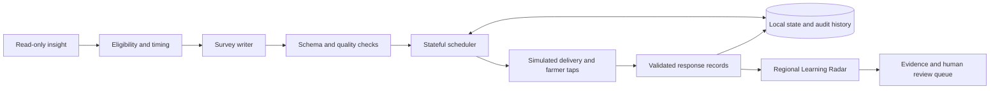

# FarmerLoop: development, demonstration and adoption plan

Planning snapshot: 2026-11-04. Branch: `feature/jeremiah-farmerloop`.
This is a proposed implementation sequence, not authorization to execute every
phase, use paid services, publish, merge, or modify teammate-owned code.

## 1. Outcome and scope

Deliver a complete demonstrable loop: relevant advice follow-up, respectful
scheduling, simulated farmer answers, regional feedback analysis, and a human
review action supported by traceable evidence. Another teammate must be able
to install, run, test and explain it without its original author present.

The distinctive contribution is the Regional Learning Radar: separate an
observed barrier among respondents from an evidence gap caused by limited
feedback or delivery problems. Do not claim that silence means success, that
a synthetic pattern represents Bihar, or that correlation proves impact.

There are three completion levels:

| Level | Meaning | Evidence required |
|---|---|---|
| Hackathon demonstration | Complete synthetic workflow, repeatable evaluation, visible AWS contribution, clear limitations | Working interaction, reports, rehearsal, fallback recording and reproducible release |
| Maintainer handoff | Someone else can operate and change the application | Fresh-checkout exercise, documented interfaces, automated checks, state backup/restore and named owners |
| Approved pilot | Digital Green can trial the system with appropriate oversight | MEL/agronomic/language acceptance, approved integrations and data handling, operational owner and monitored pilot |

A strong submission is not automatically ready to contact real farmers. Real
messaging is outside the participant-pack hackathon scope. Competition success
cannot be guaranteed; use the actual judging rubric once verified rather than
inventing weights or optimizing only for presentation polish.

## 2. Starting point and evidence

Read these as the continuing project context:

- [Original Radar handoff](REGIONAL_LEARNING_RADAR_IDEAS.md).
- [Radar implementation record](RADAR_CHECKPOINTS.md).
- [Survey quality and evaluation](SURVEY_QUALITY.md).
- [Eligibility/timing decisions and conflicts](DECISIONS.md).
- [Run instructions](../README.md).
- Official pack: `data/participant-pack/index.html`, `json/schemas/`,
  `json/rules/`, golden rows and crop calendar, relative to the repository root.

Current verified state:

- 462 tests pass. Offline pipeline, feedback and Radar demos work. The temporary
  Streamlit viewer works in English/Hindi survey modes.
- Radar scenario: 60 fictional farmers, computed district metrics, two findings,
  evidence links, and tests for missing, malformed, duplicate and conflicting data.
- Quality screening is deterministic and lexical, not a semantic/agronomic
  certification. English golden-eligible handoff coverage is 73/95; Hindi is
  72/95. English practice evaluation produces 1,714 handoffs from 2,666 selected
  eligible inputs among 6,999 rows; unsupported and invalid cases are retained.
- Eligibility agreement is 149/150. G-0136 remains disputed. Timing matches all
  five worked scenarios, but none of the 95 full golden windows exactly; the
  conflict report explains why. Do not conceal these denominators.
- Scheduling validates input, eligibility, quality and computed window, and
  rejects creation after the sending window closes. Persistent cap/opt-out
  enforcement and a delivery loop are still missing from FarmerLoop.
- Bedrock generation code exists. The current quality/Radar checkpoint does
  not establish a newly verified live AWS end-to-end workflow.
- `mel_agent/api.py`, `season.py`, `checker.py` and `app/streamlit_app.py` contain
  related teammate implementations. Their presence is not proof that they are
  compatible with FarmerLoop or that their reported evaluations transfer to it.
- Commit `7de9d2b` backs up Radar and the earlier quality checkpoint. The UI and
  subsequent timing work remain local. The downloadable Mac ZIP is an earlier
  snapshot, not an automatically updated installation.

## 3. Implementation order and design

Use the existing FarmerLoop modules as the source of business rules. Keep the
temporary Streamlit UI thin. A service layer should connect the UI, persistence
and later API adapters without copying eligibility, answer validation or Radar
formulas into each interface.

Recommended first persistence choice: SQLite with migrations, transactions,
unique record keys and a repository abstraction. It is sufficient for one
local demo process and avoids new hosted dependencies. A multi-instance cloud
service needs a reviewed durable shared store; do not place SQLite on ephemeral
serverless storage and call it production persistence.

### Checkpoint A — protect and organize the current baseline

Tasks:

1. Inventory local UI/timing changes and separate them from any teammate edits.
2. Record the exact test command, Python version, dataset/rule fingerprints and
   known limitations. Avoid promising that a test count is a quality score.
3. Prepare a reviewable commit of the current checkpoint; push when authorized.
4. Maintain one plan/status document and release notes. Record which source
   revision a downloadable package contains; include a UI version label later.
5. Verify event submission time, required links, demo length, permitted assets,
   AWS expectations, licensing and the official judging rubric. Record unknowns.

Done when: the working state is recoverable, its verification is documented,
and the remaining submission obligations have an owner or an explicit unknown.
This planning task itself does not commit or push.

### Checkpoint B — weekly limits, opt-outs and durable scheduling

Tasks:

1. Persist surveys, handoffs, attempt records, opt-outs and scheduler decisions.
   Use a simulated IST clock injected into all scheduling decisions.
2. Enforce one distinct survey per farmer in a rolling seven-day interval across
   channels. Use accepted outcome semantics for when a farmer was actually
   asked; creating a handoff alone must not consume the cap.
3. Specify the interval boundary and cap-count timestamp explicitly. Replays or
   retries of one survey must neither add a second count nor refresh its first
   counted timestamp. Exclude future observations relative to simulated time.
4. High-priority surveys bypass the cap but count after the farmer is asked.
   High priority does not override opt-out. Distinguish decline from opt-out.
5. Enforce opt-out at dispatch and retry, including already queued work. Persist
   it across restart. Treat untrusted/mismatched response identity as a failure,
   not as authority to change someone else's preferences.
6. Recheck hours, window, expiry, cap and opt-out before every attempt. Defer a
   capped survey only while its window remains open; otherwise record why it
   could not be sent. Keep response grace periods separate from delivery time.
7. Make enqueue, claim and ingest idempotent. Use transactions/reservations so
   simultaneous jobs cannot both pass a cap check. Model unknown delivery
   separately from confirmed failure; do not invent receipts.
8. Provide a demo-only reset that clears only the selected synthetic run.

Acceptance checks: second normal survey blocked; retries counted once; confirmed
failed delivery does not count when the official outcome says it should not;
high-priority exemption still counts; opt-out blocks every future channel;
restart preserves state; exact seven-day boundary behaves as documented;
concurrent dispatch and duplicated ingestion cannot double-send or double-count.

Deliverable: tested scheduler/state service with readable allow/defer/drop
reasons. This is the next substantive implementation checkpoint.

### Checkpoint C — interactive end-to-end demo

Tasks:

1. Extend the current page with a small sequence: source advice, survey,
   simulated delivery/answer, and updated Radar. Retain the original one-click
   seeded scenario for a fast reset and fallback.
2. Render the actual survey prompts/options from the existing contract. Taps
   go through FarmerLoop's response builder; no UI-only answers or metrics.
3. Offer a few controlled outcomes: seed obtained, seed unavailable, incomplete
   response, delivery failure, opt-out. Allow advancing the simulated clock.
4. Recompute analysis from validated stored records after each accepted action.
   Show before/after counts and denominators; do not pre-script finding text
   that contradicts the changed records.
5. Preserve the analyzer's immutable attempt-record assumptions. Persist raw
   lifecycle events separately if necessary and reduce them to one canonical
   attempt snapshot. Do not append conflicting partial updates under the same
   response key or silently replace prior evidence.
6. Display a simple human-review queue with evidence and a suggested action.
   Distinguish suggestion, acknowledgement and resolution; these are demo
   workflow states, not claims that a real farmer problem was solved.
7. Clearly label fictional districts, simulated time, generator mode and
   persisted demo state. Prevent accidental real messaging or AWS calls.

Acceptance checks: a submitted tap changes the correct underlying record and
metrics; duplicates do not change counts; partial responses do not fabricate a
seed-access answer; delivery failures preserve the target denominator; evidence
resolves to the displayed finding; restart/reset behaves predictably. Verify
the UI in an actual browser and on the user's Intel Mac when available.

Deliverable: a small usable demo, not a general dashboard redesign.

### Checkpoint D — better questions and defensible evaluation

Tasks:

1. Freeze the current evaluation as the baseline. Track generation coverage,
   abstention reasons, eligibility, timing, schema/language checks, response
   validity, latency and cost separately. Never count abstentions as successes.
2. Review unsupported patterns by frequency and MEL value. Expand the highest
   value ones, including whether advice was adopted, access barriers and
   relevant outcomes. Avoid overfitting to golden IDs or copied questions.
3. Define a proposed review rubric: advice relevance, one question/action at a
   time, matched options, useful uncertainty choices, no new advice, correct
   language and relevance of the timing. Obtain MEL/agronomic review of it.
4. Prepare a model-judge interface and offline mocks. When authorized, assess
   a bounded sample with Bedrock and compare a sample of verdicts with human
   review. A model score alone must not certify correctness.
5. Evaluate first-step plans, negative advice, livestock, unsupported crops,
   absent/ambiguous context and genuine post-harvest follow-ups. Native Hindi
   review needs a person; track reviewer findings and unresolved issues.
6. Add calendar context as evidence, with explicit handling of crop, stage,
   location, season, overlapping dates and missing information. Typical dates
   are not an individual harvest observation. Start with review warnings where
   semantics are uncertain; do not blanket-reject post-harvest storage surveys.
7. Retain the rule-vs-golden reconciliation. Prepare the G-0136 and timing
   questions for an organizer/MEL reviewer; do not silently relabel fixtures.
8. Add independently reviewed challenge cases beyond the data used to develop
   templates. Label existing golden results as development-set performance.

Acceptance checks: show a reproducible before/after improvement on chosen
quality measures without hiding reduced coverage or added unsafe outputs;
no regression in existing contract/identity/deduplication tests; held or failed
surveys do not reach scheduling. Report reviewer disagreements explicitly.

Deliverables: versioned rubric, reviewed examples, error analysis and evaluation
report. Any numeric relevance/coverage target is a project proposal until a
reviewer agrees it; it is not an invented official judging threshold.

### Checkpoint E — verify AWS with a controlled cost

Prepare offline first: bounded test inputs, model/region configuration, request
limits, retry policy, failure tests and per-call usage recording. Present a
concrete maximum call count and cost estimate before requesting paid execution.

After authorization:

1. Run a small supported sample through the current Bedrock writer and quality
   path. Verify valid results actually reach the demo workflow.
2. Record model/profile identifiers, prompt version, source revision, timestamps,
   input/output tokens, latency, retries and inference cost. Avoid storing secrets.
3. Demonstrate invalid-output rejection and timeout/access-error fallback. Label
   fallback output as offline, not as a successful model response.
4. Stop at the approved budget; full-dataset offline evaluation does not authorize
   thousands of paid inference calls.
5. Prepare deployable configuration/IaC appropriate to the final chosen runtime,
   minimum required permissions and cleanup instructions. Do not provision
   resources merely to make an architecture diagram look more elaborate.

Done when: a recorded, reproducible live AWS run demonstrates the final path,
cost is measured, and the demo remains usable without live inference. Local
Streamlit with Bedrock may be sufficient for the event; verify the actual AWS
submission requirement before assuming a hosted deployment is mandatory.

### Checkpoint F — integration and operation without the author

Tasks:

1. Read and test teammate API/scheduler/checker behavior before selecting reuse.
   Map schema, ID, timing, state and error differences. Do not mix a calibrated
   golden-matching policy with FarmerLoop's documented baseline silently.
2. Prefer an adapter around the existing team interface when compatible. Keep
   changes isolated until teammate integration is approved. Document one owner
   for each business rule and eliminate duplicate execution paths in the final
   supported deployment.
3. Specify request/response examples for generating a survey, obtaining status,
   ingesting a response and reading follow-ups/Radar findings. Keep richer
   internal statuses outside official schema objects where necessary.
4. Test duplicate submissions, conflicting records, wrong farmer/flow/survey,
   invalid choices, timestamps, unknown IDs and restart recovery. Production
   callers require authentication and authorization, not merely a schema pass.
5. Pin reproducible dependencies and add documented startup, reset, backup,
   restore, configuration and troubleshooting procedures. Add automated checks
   that run without AWS credentials. Check source/data licensing before release.
6. Provide structured operational logs and health/readiness checks. Monitor
   failed generation, blocked scheduling, delivery uncertainty, queue age,
   response ingestion errors and inference spend.
7. Release a versioned Mac package after the final checkpoint. Test a fresh
   checkout/package on a clean environment; ask a teammate to follow only the
   README and record anything that needed verbal help.

Done when: the teammate can run, reset, restore and troubleshoot the demo; API
contract tests pass; configuration and durable state locations are explicit;
ownership and known limitations are documented. A recorded Linux smoke test
does not substitute for claiming a completed Intel Mac user check.

### Checkpoint G — presentation and submission

Use the required event duration; prepare a three-minute core story that can be
expanded for questions:

| Approximate time | Demonstration |
|---|---|
| 0:00–0:30 | Problem: generic surveys miss advice-specific barriers and silent regions |
| 0:30–1:10 | Advice becomes a short relevant survey; simulate a farmer response |
| 1:10–2:05 | District A reports seed-access barriers; District B lacks sufficient feedback; inspect evidence |
| 2:05–2:35 | Show an answer changing the analysis, plus a cap/opt-out protection |
| 2:35–3:00 | Evaluation, AWS contribution, limitations and the proposed pilot |

Prepare a concise deck, one accurate architecture diagram, a requirements-to-
evidence checklist, release/source links and a recorded fallback. Clearly
distinguish measured outcomes, simulated observations and intended future
impact. Rehearse repeatedly from a clean demo reset and record expected values.

Final gate: required submission fields complete; artifacts correspond to the
tested source revision; no unverified claims of deployment, translation review,
population prevalence or improved crop yield. No competition ranking is promised.

## 4. Pilot and continuing use

Plan these now; execute them with Digital Green and appropriate owners after
the hackathon. Actual farmer data and messaging are not authorized by this plan.

| Workstream | What must be agreed or delivered | Accountable role |
|---|---|---|
| Product ownership | Named operational owner, developer maintainer and escalation path | Digital Green/team leads |
| MEL validity | Useful questions, follow-up actions, regional cohort definitions and threshold review | MEL lead and agronomist |
| Language/accessibility | Native Hindi review, channel usability and accessible interactions | Language reviewer and field team |
| Farmer preferences | Consent/opt-out process, retention/deletion, least necessary data and identity mapping | Digital Green product/privacy owners |
| Integrations | Approved FarmerChat contracts, channel permissions and delivery receipts | Integration owner |
| Reliability | Durable shared storage, atomic dispatch, retries, backup/restore, alerts and rollback | Engineering/operations |
| Learning | Pilot size/duration, success criteria, review cadence and stopping rules | MEL and product owners |

Pilot measures should include delivery coverage, accepted-answer coverage,
reviewer-rated relevance, opt-out rate, survey burden, cost per useful response,
staff actions taken and review turnaround. Set acceptable levels with the
operator before launching. High response volume alone is not success.

Use shadow review before controlled delivery: humans inspect proposed surveys
and Radar findings before farmers are contacted. Stop or roll back for opt-out
violations, materially inappropriate surveys, identity errors or misleading
regional claims. A larger study is needed to establish agricultural impact.

Maintainers need an issue backlog, policy-change process, evaluated releases,
incident guide, dependency update routine and a small operational budget.
The software can automate mechanics; someone must own agricultural judgment,
farmer support and the actions prompted by the findings.

## 5. Time allocation, dependencies and scope cuts

Work in the sequence A → B → C → D → E → F → G, while preparing documentation,
rubric and submission materials early. Interface decisions in F should inform
B before either scheduler is extended. D's evaluator preparation can proceed
without paid AWS; live evaluation in D/E waits for authorization. A final live
run must use the final writer/quality path rather than an abandoned prototype.

Planning estimates, not delivery promises: A 30–60 minutes; B 2–4 focused hours;
C 2–4; D 3–6 plus reviewer availability; E 1–3 plus access/approval; F 3–6;
G 1–2. Discoveries or integration issues can expand these ranges. A real pilot
has a separate schedule agreed with its owner.

If only one hackathon day remains, prioritize B, a narrow C, a bounded quality/
AWS proof and a reproducible G. Reserve the final 60–90 minutes for freeze,
rehearsal and submission. Reuse proven team components where compatible. Cut
cosmetic redesign, extra languages, maps, voice, broad new crops and elaborate
cloud infrastructure first. Do not drop honest reporting, opt-out handling,
critical validation or a working fallback to fit the schedule. Record anything
not finished instead of calling it complete.

## 6. Checkpoint working agreement

At each checkpoint, provide: what changed; relevant test/evaluation results;
remaining limitations; a runnable demonstration; and a short proposed next step.
Stop for user review before advancing to another implementation checkpoint.
This follows the project's supervised checkpoint workflow, not a requirement
to ask permission for every routine edit within an approved checkpoint.

Keep `main`, official participant data and teammate code untouched unless the
user authorizes that scope. Git pushes, paid AWS and actual deployment use the
applicable session authorization; do not infer blanket authorization from this
planning request. Review concrete prepared changes before requesting any
additional approval.

Next proposed implementation: **Checkpoint B — persistent weekly limits and
opt-out enforcement**, after reviewing the local baseline and the teammate
interfaces needed to avoid inconsistent rules.
